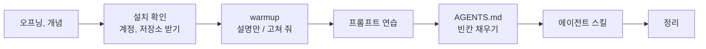

# 세션 1 — AI와 코딩하는 법

이 문서는 세션 1의 진행 순서입니다. 준비를 끝내고, AI에게 말 거는 법과 규칙 파일(AGENTS.md), 스킬을 연습합니다.



오늘의 개념은 이렇습니다.

- AI가 코드를 써 주는 시대에도 무엇을 만들지 정하고 결과를 확인하는 일은 사람이 합니다.
- 아무것도 확인하지 않고 AI에게 맡기는 방식을 "바이브 코딩"이라고 합니다.
- 말로 정하고 직접 확인하는 방식을 "책임감 있는 AI 지원 개발"이라고 합니다.
- 오늘은 코드를 읽지 않습니다. 명세, 예시표, 프롬프트, 테스트 결과를 읽습니다.
- 명세(SDD)가 처음이라면 [개념 노트](00-concepts.md)의 11절 "SDD 쉽게 이해하기"를 봅니다.

AI 도구는 두 가지를 다 직접 씁니다.

- VS Code의 GitHub Copilot: 편집기 안의 AI 도우미 (`docs/01-copilot-guide.md`)
- agy: 터미널에서 쓰는 AI 에이전트 (사용법은 `docs/01-copilot-guide.md` 7절)

Copilot 무료 플랜은 자동완성이 월 2,000회이고, 채팅과 에이전트는 크레딧 기반으로 제한됩니다.

> 안전 규칙
> - AI 채팅에 비밀번호, API 키, 실제 고객 정보, 회사 코드는 넣지 않습니다.
> - 결제 수단은 어디에도 등록하지 않습니다.

---

## 1. 오프닝

오늘의 목표와 진행 방식을 듣습니다.

- 오늘 만드는 것: 가상 쇼핑몰 하루마켓의 리뷰 온도계(`REQUEST.md`)
- 세션 1은 준비와 연습, 세션 2는 명세·테스트·코드, 세션 3은 배포, 세션 4는 쿠폰 API(4-1)와 새 프로젝트를 명세부터 만드는 SDD·TDD 실습(4-2)입니다.
- 오늘의 리듬: 명세(예시표) → 테스트(Red) → 코드(Green) → 수정 범위 확인(`git diff --stat`)
- 위의 안전 규칙 두 줄을 함께 읽습니다. 카드 입력 화면이 나오면 멈추고 손을 듭니다.

---

## 2. 개념 이야기

### 2-1. 바이브 코딩

바이브 코딩은 2025년 초 안드레이 카파시(AI 연구자)가 말해서 유명해졌습니다. 코드를 보지 않고 분위기(vibe)에 맡기고, 에러가 나면 복사해서 AI에게 던지는 방식입니다. Google Cloud는 이것을 두 가지로 나눕니다.

| 방식 | 뜻 | 어울리는 곳 |
|---|---|---|
| 순수한 바이브 코딩 | 돌아가면 끝 | 하루짜리 장난감 |
| 책임감 있는 AI 지원 개발 | 테스트와 변경 내용을 직접 확인 | 업무용 서비스 |

AI와 일하는 흐름은 반복 고리(loop)입니다.

목표 설명 → 생성 → 실행·관찰 → 피드백 → 처음으로

오늘 하루 이 고리를 계속 돕니다. 실행·관찰 칸은 건너뛰지 않습니다.

### 2-2. 개발은 코드 작성만이 아닙니다

개발자의 일은 다섯 칸입니다.

1. 무엇을 만들지 정하기
2. 설계
3. 코드 작성
4. 테스트·확인
5. 배포·운영·고치기

AI가 가장 빨라진 곳은 3번입니다. "개발의 80%는 코드 작성이 아니다"는 통계가 아니라 업계에서 흔히 하는 말입니다. AI가 코드를 빨리 써 줄수록 1번(무엇을 만들지)과 4번(맞는지 확인)이 사람에게 남습니다. 오늘 수업은 이 두 칸을 다룹니다.

AI 코딩 도구는 얼마나 알아서 움직이는지(자율성)에 따라 세 유형이 있습니다.

| 유형 | 비유 | 오늘 |
|---|---|---|
| 앱 빌더 | 한 줄로 완성품을 만듦. 빠르지만 고치기 어려움 | 쓰지 않음 |
| IDE 어시스턴트 (VS Code의 Copilot) | 편집기 옆의 페어 프로그래머 | 직접 씀 |
| 터미널 에이전트 (agy, Claude Code, Codex CLI) | 일을 맡기는 주니어 개발자 | agy를 직접 씀 |

알아서 움직이는 도구일수록 맡길 범위와 확인 기준을 먼저 정합니다.

### 2-3. 도구별 역할

학생은 이 시간에 GitHub와 Copilot 로그인을 함께 시작합니다.

| 도구 | 역할 |
|---|---|
| GitHub | 코드 보관, 자동 테스트(Actions) |
| VS Code + Copilot | 내가 직접 쓰는 편집기와 AI 도우미 |
| agy | 터미널에서 쓰는 AI 에이전트 |
| Render (또는 Vercel) | 서비스를 인터넷 주소로 열어 주는 곳 |

---

## 3. 설치 확인, 계정, 저장소 받기

설치는 이미 되어 있습니다. 설치 확인, 계정 만들기, 저장소 받기, 서버 켜기를 합니다. 남는 시간은 질문과 따라잡기에 씁니다.

`docs/01-setup-card.md`를 펼쳐 놓고 위에서부터 차례로 합니다. 카드에 명령이 모두 있습니다. 명령은 VS Code 안의 터미널에서 칩니다.

- Python 확장(ms-python.python)은 교육장 PC에 미리 설치되어 있습니다. `Python: Select Interpreter`가 안 보이면 왼쪽 Extensions(네모 4개 아이콘)에서 Python을 검색해 Install 합니다.
- Mac은 편집기 단축키에서만 `Ctrl` 대신 `Cmd`를 씁니다. 터미널에서 서버를 끄는 `Ctrl+C`는 Mac도 `Ctrl`입니다.

순서는 이렇습니다.

1. GitHub에 가입하고, 템플릿에서 내 저장소를 만듭니다. Include all branches를 체크합니다.
2. Render 계정을 만듭니다. render.com에서 GitHub로 가입하고, 결제 수단은 넣지 않고, 이메일 인증까지 합니다. 세션 3에서 이 계정으로 로그인합니다.
3. VS Code 터미널을 열고 설치 확인(README 블록 ①)을 합니다: `python --version`, `git --version`, `code --version`, `agy --version`
4. 저장소를 받습니다(README 블록 ②): `git clone` → `cd review-thermo` → `code -r .`
   - VS Code 첫 실행 창 "이 폴더를 신뢰합니까?"는 Yes, I trust를 누릅니다. 추천 확장 알림은 닫습니다.
5. `python --version`(Mac `python3 --version`)이 3.11 이상(3.12 권장)인지 다시 봅니다.
6. 가상환경을 만들고(README 블록 ④ macOS, ⑤ Windows) 패키지를 설치합니다. 이어서 Python 인터프리터를 선택합니다.
   - Windows 순서: `Set-ExecutionPolicy`(한 번만) → `python -m venv .venv` → `.venv\Scripts\Activate.ps1` → `pip install`. 명령 전체는 `docs/01-setup-card.md`에 있습니다.
7. push 연습: README 첫 줄 끝에 내 이름을 적고 push 합니다(README 블록 ⑨). Public 저장소에서는 commit에 이메일이 보입니다. 원하지 않으면 GitHub Settings → Emails의 noreply 주소를 씁니다.
8. Copilot Free에 로그인하고 상태를 점검합니다(`docs/01-copilot-guide.md`).
   - 채팅은 VS Code 맨 위 가운데 검색창 옆 채팅 아이콘으로 엽니다. 단축키는 Windows `Ctrl+Alt+I`, Mac `Ctrl+Cmd+I`입니다.
   - 모드 드롭다운은 입력창 아래에 있습니다.
9. agy에 로그인합니다. 새 터미널에서 프로젝트 폴더로 가서 `agy`를 입력하고, 내 Google 계정으로 로그인합니다. 비밀번호는 로그인 화면에만 입력하고 AI 채팅에는 넣지 않습니다.
10. 서버를 켭니다(README 블록 ⑥): `uvicorn app.main:app --reload` → 브라우저에서 `http://localhost:8000`. 내 PC에서는 `MODEL_REPO`를 입력하지 않습니다.
11. `pytest -v`(README 블록 ⑦)를 한 번 실행하고, 마지막 줄(`2 failed, 4 passed`)을 워크북 2-6의 "수업 시작" 칸에 적습니다. pytest가 처음이면 `docs/02-pytest.md`를 읽습니다.
12. 워크북을 복사합니다(처음 한 번). VS Code 탐색기에서 `WORKBOOK.md`를 복사해 `notes/MY_WORKBOOK.md`로 붙여 넣습니다.
    - 터미널로는 macOS `mkdir -p notes && cp WORKBOOK.md notes/MY_WORKBOOK.md`, Windows PowerShell `mkdir notes; copy WORKBOOK.md notes\MY_WORKBOOK.md`입니다.
    - 내 답은 이 파일에만 씁니다. 따라잡기 명령은 `WORKBOOK.md`를 덮어써도 `notes/`의 내 파일은 건드리지 않습니다.
    - 이 파일은 push 하면 공개 저장소에 올라갑니다. 개인 정보와 키는 쓰지 않습니다.

### 확인 포인트

- [ ] `python --version`, `git --version`, `code --version`, `agy --version`에 버전이 나오고, Python이 3.11 이상이다
- [ ] Render 계정을 만들었다 (GitHub로 가입, 이메일 인증까지, 결제 수단은 넣지 않았다)
- [ ] 터미널 앞에 `(.venv)`가 보인다 (새 터미널을 열어도 보인다)
- [ ] 내 GitHub 저장소 화면에 push 연습 commit이 보인다
- [ ] Copilot Chat에 `안녕`을 쓰면 답이 오고, 모드 드롭다운에 Ask와 Agent가 보인다
- [ ] agy에 로그인했고, `안녕`에 답이 온다
- [ ] 화면에서 분석을 누르면 "아직 구현되지 않았어요 (501)"가 나온다
- [ ] `pytest -v` 마지막 줄(`2 failed, 4 passed`)을 워크북 2-6 "수업 시작" 칸에 적었다
- [ ] `notes/MY_WORKBOOK.md`를 만들었다

501이 나오면 성공입니다. 아직 아무것도 안 만들었으니 당연합니다. 오늘 이 501을 없앱니다.

### 막혔을 때

- 설치 확인에서 명령을 찾을 수 없다는 글이 나오면 손을 듭니다. 교육장 PC에는 설치되어 있어야 합니다.
- 화면 메시지 뜻은 `docs/00-troubleshooting.md`에서 찾습니다.
- Include all branches를 놓쳤거나, Copilot이나 agy 한도가 막혔거나, 네트워크가 막히면 붙잡지 말고 손을 듭니다.

---

## 4. AI에게 코드 설명시키기와 버그 찾기 (warmup)

`warmup/orders.py`는 주문 금액 계산 같은 작은 함수 3개가 들어 있는 연습 파일입니다. 버그(오류)가 숨어 있습니다. 코드를 못 읽어도 괜찮습니다. AI에게 설명시킵니다.

이 실습은 슬라이드 없이 직접 하고, 기록은 워크북 1-3에 합니다. Copilot과 agy 중 하나로 합니다.

### 4-1. "설명만" 시키기

Copilot은 Ask 모드로 바꿉니다. agy는 아래 글에 "고치지 말고"가 들어 있으므로 그대로 보냅니다. 파일을 채팅창에 끌어놓거나 파일 이름을 적습니다.

```text
먼저 AGENTS.md 를 읽어 주세요. (AI가 자동으로 읽지 않을 수 있어서 직접 씁니다)
warmup/orders.py 를 코딩을 처음 배우는 사람이 알아듣게 설명해 줘.
고치지 말고 설명만 해 줘.
버그가 있으면 어떤 입력을 넣을 때 틀린 결과가 나오는지 예를 하나씩 보여 줘.
```

다른 터미널에서 확인합니다(README 블록 ⑧).

```text
git diff --stat
```

아무것도 안 나오면 바뀐 파일이 없다는 뜻입니다.

### 4-2. "고쳐 줘" 시키기

이번에는 Copilot Agent 모드 또는 agy로 보냅니다. Agent 모드는 세션당 2~3번만 씁니다. 지금 1번 씁니다.

> Agent가 명령 실행 승인을 물으면 명령 한 줄을 읽고 `pytest`, `git status`, `git diff` 류만 허용합니다. 나머지와 삭제 명령은 거절합니다. '항상 허용'은 누르지 않습니다.

```text
warmup/orders.py 의 버그를 고쳐 줘.
```

다시 확인합니다.

```text
git diff --stat
```

예시 화면입니다. 파일 이름과 숫자는 다를 수 있습니다.

```text
 warmup/orders.py | 8 +++++---
 1 file changed, 5 insertions(+), 3 deletions(-)
```

"고쳐 줘"는 AI가 마음대로 바꾸는 일입니다. 어디를 바꿨는지는 내가 확인합니다. AI가 자기 터미널을 따로 열면 그 결과는 믿지 말고, 내 터미널에서 직접 실행합니다.

연습이 끝나면 원래대로 되돌립니다.

```text
git restore warmup/orders.py
```

### 4-3. 두 도구 비교

같은 부탁을 Copilot과 agy에 한 번씩 보내 봅니다. 아직 안 써 본 도구로 4-1의 "설명만"을 보냅니다.

1. 답의 길이와 말투가 어떻게 다른지 봅니다.
2. 버그를 몇 개 찾았는지 셉니다.
3. `git diff --stat`이 비어 있는지 확인합니다.
4. 비교한 점을 워크북 1-3 표 아래에 한 줄로 적습니다.

### 확인 포인트

- [ ] "설명만" 뒤의 `git diff --stat`이 비어 있었다
- [ ] "고쳐 줘" 뒤의 `git diff --stat`에 `warmup/orders.py`가 나왔다
- [ ] `git restore`로 되돌린 뒤 `git diff --stat`이 다시 비었다
- [ ] Copilot과 agy를 한 번씩 썼다

### 막혔을 때

- AI가 파일을 못 찾으면 `warmup/orders.py`를 정확히 적었는지 봅니다.
- 한도가 막히면 남은 도구로 합니다. 둘 다 막히면 손을 듭니다.

---

## 5. 프롬프트

### 5-1. 프롬프트는 작은 요구사항 정의서

프롬프트는 AI에게 주는 요구사항 정의서입니다. 일반 프롬프트에는 네 칸이 있습니다.

| 칸 | 뜻 |
|---|---|
| 역할 | 누구로서 답하는가 |
| 근거 | 무엇에만 근거하는가 (붙여 준 파일에만) |
| 형식 | 어떻게 생긴 답인가 (표, 3줄) |
| 모를 때 | 없으면 어떻게 하는가 ("확실하지 않으면 어디를 확인할지 알려 줘") |

네 칸 중 하나라도 비면 AI가 그 칸을 스스로 채웁니다. 빈칸은 AI가 확률로 메웁니다.

코딩에서는 실행 환경("Python 3.11 이상, FastAPI, 새 패키지 없이")이 5번째 칸으로 붙습니다. "알아서 잘 해 주세요"는 요구사항 정의서에도 프롬프트에도 없는 말입니다.

자세한 표는 `docs/01-prompt-sheet.md`, 나중에 읽을 개념은 `docs/00-concepts.md`에 있습니다.

### 5-2. 개발 부탁 4칸

앞의 프롬프트 칸을 개발 부탁용으로 바꾼 것이 4칸입니다.

| 칸 | 뜻 | 일반 프롬프트의 어느 칸 |
|---|---|---|
| 원하는 것 | 무엇을 만들까 | 작업, 산출물 |
| 방법 힌트 | 어느 파일에, 어떤 규칙으로, 실행 환경 | 근거 + 실행 환경 |
| 하지 말 것 | 건드리면 안 되는 것 | 제약, 예외 |
| 완료 기준 | 끝났다고 말할 수 있는 조건 | 형식 + 검수 기준(테스트) |

```text
[원하는 것] / [방법 힌트] / [하지 말 것] / [완료 기준]
```

습관 두 가지입니다.

- 싱글턴 지향: 한 번에 잘 설명해서 한 번에 끝냅니다. 엉뚱하면 새 대화로 다시 시작합니다(Copilot은 `/clear`).
- 프리모템(보내기 전 점검): "이 프롬프트가 의도대로 안 될 경우의 수는?" 하나만 묻습니다.

### 5-3. 프롬프트 연습 (슬라이드 promptlab, 워크북 1-2)

대상 코드는 `warmup/orders.py`입니다. 결과를 비교하는 연습이므로 Copilot은 Ask 모드로 하고, 파일은 고치지 않습니다.

1. 짧게 보내기: `이 코드 설명해 줘`만 보냅니다.
2. 4요소로 다시 쓰기: 역할·근거·형식·모를 때 네 칸을 채워 `warmup/orders.py` 설명을 받습니다.

```text
너는 코딩을 처음 가르치는 선생님이야. (역할)
첨부한 warmup/orders.py 에 있는 내용에만 근거해 줘. (근거)
함수 3개를 하나씩, 표나 3줄로 설명해 줘. (형식)
확실하지 않으면 어디를 확인할지 알려 줘. (모를 때)
```

3. 두 답 비교: 1번과 2번의 답을 나란히 놓고 달라진 점(길이, 구체성, 모른다고 말한 곳)을 적습니다.
4. 개발 부탁 4칸 쓰기: `warmup/orders.py`의 버그 하나를 고치는 부탁을 4칸(원하는 것, 방법 힌트, 하지 말 것, 완료 기준)으로 씁니다. 쓴 뒤 짝과 바꿔 읽고, 비어 있거나 모호한 칸을 서로 알려 줍니다. 보내지는 않습니다.
5. 기록: 1~4번 결과를 워크북 1-2에 적습니다.

5번째 칸인 실행 환경은 이번에는 비워도 됩니다.

### 5-4. 대화가 길어지면 새 채팅

AI는 컨텍스트 창(AI가 한 번에 보는 작업 책상)에 들어 있는 것만 봅니다. 대화가 길어지면 책상 위가 어지러워집니다.

| 어지러운 것 | 일어나는 일 |
|---|---|
| 오래된 결정 | 바꾼 규칙과 옛 규칙이 섞임 |
| 실패한 시도의 잔해 | 틀린 코드를 계속 참고함 |
| 관계없는 대화 | 지금 일과 상관없는 내용이 쌓임 |

이럴 때는 새 채팅을 열고 필요한 파일만 붙여서 다시 시작합니다. 직접 해 봅니다.

1. Copilot Chat 패널 위쪽의 + 버튼으로 새 채팅을 엽니다. 이전 대화는 기억하지 못합니다. 새 책상입니다.
2. 탐색기에서 `AGENTS.md`를 채팅창으로 끌어놓아 첨부합니다. 파일 이름만 적는 것보다 확실합니다.
3. 아래처럼 보냅니다(Ask 모드).

```text
첨부한 AGENTS.md 를 읽고, 이 프로젝트에서 내가 허락 없이 고치면 안 되는 파일 목록을 알려 줘.
```

앞 대화를 모르는데도 목록이 나오면 성공입니다. 중요한 결정은 대화가 아니라 파일에 있어야 합니다.

다음 세션부터는 `AGENTS.md`와 `SPEC.md` 두 파일을 붙여서 이어 갑니다(`docs/01-prompt-sheet.md`의 "새 채팅 시작" 프롬프트).

### 확인 포인트

- [ ] "이 코드 설명해 줘"와 4요소로 쓴 부탁의 답을 비교해 적었다 (워크북 1-2)
- [ ] 개발 부탁 4칸을 쓰고 짝과 바꿔 읽었다 (워크북 1-2)
- [ ] 새 채팅에서 `AGENTS.md`를 첨부해 같은 질문에 답을 받았다

---

## 6. AGENTS.md 빈칸 채우기

`AGENTS.md`는 AI가 일을 시작하기 전에 읽는 "프로젝트 안내서"입니다. 미리 써 둔 규칙이 많습니다. 빈칸 4곳(`빈칸:`이 적힌 주석)만 내가 채웁니다.

1. VS Code에서 `AGENTS.md`를 엽니다.
2. `Ctrl+F`(Mac `Cmd+F`)로 `빈칸:`을 검색합니다. 머리말 한 곳과 채울 곳 4곳이 나옵니다.
3. 내 말로 한 줄씩 채우고, 주석 표시(`<!-- ... -->`)는 지웁니다.

힌트입니다.

- 한 줄 설명: 친구에게 말하듯 씁니다.
- 서버 명령: 방금 쓴 `uvicorn app.main:app` 뒤에 `--reload`를 붙입니다.
- 막고 싶은 행동: 예) 새 패키지 설치
- 보고할 것: 예) 바꾼 파일 목록

저장한 뒤 AI가 정말 읽는지 확인합니다. Copilot Chat(Ask) 또는 agy에서 보냅니다.

```text
먼저 AGENTS.md 를 읽어 주세요. 그리고 이 프로젝트에서 내가 허락 없이 고치면 안 되는 파일 목록을 알려 줘.
```

목록에 `SPEC.md`, `static/`이 들어 있으면 성공입니다.

마지막으로 저장하고 올립니다.

```text
git add AGENTS.md
git commit -m "AGENTS.md 빈칸 채우기"
git push
```

### 확인 포인트

- [ ] AGENTS.md에서 `빈칸:`을 검색했을 때 머리말 한 곳만 나온다
- [ ] AI가 금지 파일 목록을 제대로 말했다
- [ ] push가 끝났다 (GitHub 저장소 화면에 새 commit이 보인다)

### 막혔을 때

빈칸을 못 채웠거나 push가 안 되면 완성본을 가져옵니다.

```text
git fetch origin
git checkout origin/cp1-setup -- AGENTS.md
```

브랜치 이름 표는 `docs/00-troubleshooting.md`에 있습니다.

---

## 7. 에이전트 스킬: 찾고, 읽고, 써 보기

스킬은 특정 작업의 레시피를 담은 폴더입니다. 폴더 안에 `SKILL.md` 한 장이 꼭 있습니다.

`AGENTS.md`는 대화마다 항상 읽힙니다. 스킬은 필요할 때만 본문이 불려 옵니다.

### 7-1. 어디에 두나

| 위치 | Copilot (VS Code) | agy |
|---|---|---|
| `.agents/skills/<이름>/` (프로젝트, 오늘 사용. `<이름>` 자리에 폴더 이름을 씁니다) | 읽음 | 읽음 |
| `.github/skills/<이름>/` | 읽음 | 안 읽음 |
| `.claude/skills/<이름>/` | 읽음 | 안 읽음 |
| `~/.copilot/skills/` (내 PC 전체) | 읽음 | 안 읽음 |
| `~/.gemini/antigravity-cli/skills/` (내 PC 전체) | 안 읽음 | 읽음 |

### 7-2. SKILL.md의 모양

맨 위 `---`와 `---` 사이의 설정 부분을 frontmatter라고 합니다.

```text
.agents/skills/spec-to-tests/
├── SKILL.md
└── examples/row.py
```

```markdown
---
name: spec-to-tests
description: SPEC.md의 예시표를 tests/ 의 pytest 데이터 행으로 옮긴다. "예시표를 테스트로", "테스트 행 만들어 줘"라고 할 때 사용한다.
argument-hint: "함수 이름들 (예: to_label to_temperature is_mismatch)"
---
# 예시표 → 테스트 행
1. SPEC.md에서 적어 준 함수들의 예시표를 찾는다. 함수 이름을 적지 않았으면 SPEC.md의 모든 예시표를 옮긴다.
...
```

- `name`: 소문자, 숫자, 하이픈만 씁니다. 64자 이하이고 폴더 이름과 같아야 합니다. 다르면 오류 없이 조용히 무시됩니다.
- `description`: 무엇을 하고 언제 쓰는지 적습니다. AI는 이 한 줄을 보고 스킬을 쓸지 정합니다(1024자 이하).
- 선택: `argument-hint`(`/` 명령 뒤 안내 문구), `user-invocable: false`(`/` 메뉴에서 숨김), `disable-model-invocation: true`(`/` 명령으로만 실행)

AI가 스킬을 읽는 순서입니다.

1. 모든 스킬의 name과 description만 봅니다.
2. 부탁과 맞으면 SKILL.md 본문을 읽습니다.
3. 본문이 가리킬 때만 `examples/`, `scripts/` 같은 파일을 읽습니다.

부르는 법은 두 가지입니다. description이 부탁과 맞으면 자동으로 쓰입니다. 또는 채팅에 `/스킬이름 추가설명`을 씁니다.

### 7-3. 남이 만든 스킬 찾기

| 어디서 | 하는 법 |
|---|---|
| awesome-copilot (GitHub 공식 모음) | github.com/github/awesome-copilot/tree/main/skills 에서 Ctrl+F로 `pytest`, `commit` 같은 단어를 검색합니다. 폴더 이름이 스킬 이름입니다 |
| 터미널 (참고, 강사 시연) | `gh skill search pytest`(공개 저장소 전체의 SKILL.md 검색), `--owner github`(공식만), `gh skill preview github/awesome-copilot pytest-coverage`(설치 없이 미리 읽기) |
| VS Code (실험 기능, 참고) | 설정 `chat.customizations.marketplace.enabled` → Agent Customizations → Discover → GitHub Feed |

고르는 기준입니다.

- 공식 저장소인가, 별 수가 많은가
- description이 내 작업과 맞는가
- 본문이 짧고 분명한가
- `scripts/` 없이 글만 있으면 더 안전합니다.

파이썬 백엔드용 추천입니다(모두 awesome-copilot).

| 스킬 | 하는 일 |
|---|---|
| `pytest-coverage` | 커버리지(테스트가 확인하는 코드 비율) 채우기 |
| `test-gap-audit` | 빠진 테스트 찾기. 읽기만 하고 `scripts/`가 있음 |
| `security-review` | 취약점 찾기 |
| `sql-code-review` | DB를 붙일 때 SQL 검사 |
| `multi-stage-dockerfile` | 배포용 Dockerfile |

스킬을 넣는 방법 두 가지는 강사가 시연합니다.

- 방법 A (브라우저, SKILL.md 한 장짜리): VS Code 탐색기에서 `.agents/skills/<name과 같은 폴더>/`와 그 안의 `SKILL.md`를 새로 만듭니다. GitHub에서 SKILL.md의 Raw(글자만 보이는 화면)를 열어 전체를 복사해 붙여 넣고 저장합니다. 점검표로 읽고 고친 뒤 `git add .agents/skills` → commit → push 합니다.
- 방법 B (터미널, 폴더 통째로): `gh skill install github/awesome-copilot pytest-coverage` → `ls .agents/skills`(Windows `dir .agents\skills`)로 확인합니다. Copilot 채팅의 `/skills` 메뉴와 agy 대화 화면의 `/`에서 보이는지 봅니다.

### 7-4. 설치 방법 한눈에

| 방법 | 하는 법 |
|---|---|
| 브라우저 (강사 시연, 오늘 스킬은 템플릿에 이미 들어 있음) | VS Code 탐색기에서 `.agents/skills/<이름>/`과 `SKILL.md`를 새로 만들고, GitHub Raw 화면 전체를 복사해 붙여 넣고 저장. 원문이 바뀌었으면 저장소의 `docs/skill-backup/<이름>/` 폴더를 `.agents/skills/`로 복사 |
| VS Code (실험 기능, 참고) | 설정 `chat.customizations.marketplace.enabled` 켜기 → Agent Customizations → Discover → GitHub Feed → Install |
| GitHub CLI (참고, 강사 시연) | `gh skill install github/awesome-copilot add-educational-comments` (`--scope user` 개인 설치, `--pin v1.2.0` 버전 고정) |
| agy (참고, 강사 시연) | `agy plugin install https://github.com/<owner>/<repo>` (`<owner>/<repo>` 자리에 실제 이름) → `agy plugin list --json`으로 확인 |

### 7-5. 설치 전에 반드시 읽기

스킬은 AI에게 주는 명령서입니다. 설치는 남이 쓴 명령을 내 AI에게 넣는 일입니다.

예를 들어 awesome-copilot의 `conventional-commit` 스킬에는 "Copilot will automatically run the following command in your integrated terminal (no confirmation needed)"라는 문장이 있습니다. 확인 없이 commit 명령을 실행하라는 뜻입니다.

설치 전 점검표입니다.

- [ ] 출처: 공식 저장소인가, 라이선스가 있나
- [ ] 본문의 터미널 명령: 확인 없이 실행하라는 말이 있나
- [ ] `scripts/` 폴더 안 파일: 무엇을 실행하나
- [ ] `allowed-tools`(스킬이 쓸 수 있는 도구 목록): 터미널(Bash) 같은 도구를 허용하나
- [ ] 외부 주소: 내 코드나 데이터를 밖으로 보내나

### 7-6. 실습

`add-educational-comments` 스킬은 템플릿에 이미 들어 있습니다. 받는 방법은 7-3, 7-4에서 강사가 보여 줍니다. 학생 실습은 아래 순서입니다.

1. VS Code 탐색기에서 `.agents/skills/add-educational-comments/SKILL.md`를 엽니다. 이미 들어 있는 파일입니다. 만들거나 복사하지 않습니다.
2. 위 점검표대로 SKILL.md를 읽습니다. 이 스킬에는 "Use only characters available on a standard QWERTY keyboard"(영문 자판 글자만 쓰기) 규칙이 있어서 한국어 주석과 부딪힙니다.
3. 그 줄을 `- Comments may be written in Korean.`으로 고쳐 저장합니다. 받은 스킬은 내 프로젝트에 맞게 고쳐 씁니다. 파일이 지워졌거나 꼬였으면 `docs/skill-backup/add-educational-comments/`의 `SKILL.md`로 다시 덮어씁니다.
4. Copilot Agent 모드에서 보냅니다. 명령 실행 승인을 물으면 `pytest`, `git status`, `git diff` 류만 허용하고 '항상 허용'은 누르지 않습니다.

```text
/add-educational-comments warmup/orders.py 한국어로
```

5. `git diff --stat`으로 `warmup/orders.py`만 바뀌었는지 확인합니다.
6. `.agents/skills/spec-to-tests/SKILL.md`를 열어 읽습니다. 세션 2에서 `/spec-to-tests to_label`처럼 씁니다.
7. agy 대화 화면에서 `/`를 입력합니다. 스킬 목록에 `add-educational-comments`와 `spec-to-tests`가 보이는지 확인합니다.

### 확인 포인트

- [ ] `.agents/skills/add-educational-comments/SKILL.md`를 열었고, name이 폴더 이름과 같다
- [ ] 점검표 다섯 줄을 확인했고, QWERTY 줄을 고쳤다
- [ ] Copilot이 스킬을 써서 주석을 달았고, `git diff --stat`에 `orders.py`만 보인다
- [ ] agy의 `/` 목록에서 스킬이 보인다

참고: [VS Code — Use Agent Skills](https://code.visualstudio.com/docs/agent-customization/agent-skills) · [Antigravity — Agent skills](https://antigravity.google/docs/skills) · [gh skill install](https://cli.github.com/manual/gh_skill_install)

---

## 8. 정리

- AGENTS.md는 AI에게 하는 부탁이고, 테스트와 CI는 어길 수 없는 강제입니다.
- 오늘 익힌 것: 4칸 프롬프트, AGENTS.md, 새 채팅, 스킬
- 다음 세션에서 501을 없앱니다.
