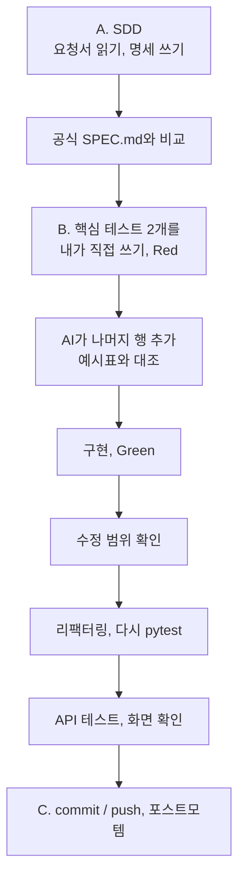
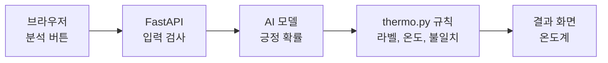

# 세션 2 — 명세 → 테스트 → 코드

이 문서는 세션 2의 진행 순서입니다. 명세를 쓰고, 테스트를 먼저 만들고, 그다음 코드를 만들어 501을 없앱니다.

출발점 맞추기: 늦었으면 지금 맞추고 시작합니다. 이 세션의 브랜치는 `cp1-setup`입니다(README 블록 ⑩).

```text
git fetch origin
git checkout origin/cp1-setup -- .
```

그다음 commit 합니다.

오늘의 개념은 이렇습니다.

- SDD(명세 주도 개발): 코드보다 먼저 "무엇을 만들지"를 글(명세)과 예시표로 정합니다.
- TDD(테스트 주도 개발): 예시표를 먼저 테스트로 만들고(실패 = Red), 그다음 코드를 만들어 통과(성공 = Green)시킵니다. 통과한 뒤에는 동작은 그대로 두고 코드를 읽기 쉽게 정리합니다(리팩터링 = Refactor).
- 가장 중요한 테스트 2개는 내가 직접 씁니다. 나머지 행은 AI가 같은 파일에 추가합니다.
- AI가 코드를 써도 무엇이 정답인지는 사람이 명세로 정합니다.

> 안전 규칙
> - AI 채팅에 비밀번호, API 키, 실제 고객 정보, 회사 코드는 넣지 않습니다.
> - 결제 수단은 어디에도 등록하지 않습니다.



AI 도구는 Copilot과 agy 중 편한 쪽을 씁니다. 두 도구를 번갈아 써 봐도 좋습니다.

---

## A. SDD — AI와 명세서 쓰기

### A-1. 요청서 읽기

`REQUEST.md`를 읽습니다. 1차 요청은 3가지입니다.

1. 긍정/부정 알려 주기
2. 0~100℃ 온도 보여 주기
3. 별점과 내용이 반대인 리뷰 표시하기

### A-2. 같은 부탁, 다른 결과

세 명이 각자 Copilot Chat 또는 agy에 아래 문장을 그대로 넣습니다. 고치거나 덧붙이지 않는 것이 규칙입니다.

```text
리뷰가 얼마나 좋은지 온도로 보여 주는 함수 만들어 줘.
```

- Copilot은 Ask 모드로 보냅니다. 모드 드롭다운은 채팅 입력창 아래에 있습니다.
- 파일은 저장하지 않습니다.
- 끝나면 `git status`가 깨끗한지 확인합니다.

결과를 나란히 놓고 비교합니다.

- 계산식
- 소수점 자리
- 정확히 0.5일 때의 처리
- 함수 이름

결과가 다른 이유는 AI 실력이 아니라 우리 부탁이 모호했기 때문입니다. AI는 모호한 곳을 각자 다르게 추측해서 채웁니다. 문제는 코드가 아니라 의도입니다. 이 경험이 다음 단계 명세서를 쓰는 이유가 됩니다.

### A-3. 명세의 세 기둥과 EARS

명세는 프롬프트가 아니라 계약입니다. 계약에는 완료를 증명하는 방법이 들어갑니다. 명세는 세 가지를 담습니다.

| 기둥 | 질문 | 오늘의 예 |
|---|---|---|
| 맥락(Context) | 왜, 누구를 위해, 무엇을 받고 돌려주나 | 입력: 리뷰 글, 별점 / 출력: 긍정·부정, 온도, 불일치 |
| 통제(Control) | 무엇을 만들고 무엇은 하지 않나 | 0.5 이상이면 긍정 / 빈 글, 별점 6은 거절 / 리뷰 저장 안 함 |
| 정확성(Correctness) | 완료를 어떻게 증명하나 | 예시표 0.8732 → 87.3℃. 이 표가 곧 테스트입니다 |

세 번째 기둥인 예시표가 수용 기준(이 조건을 통과하면 합격)입니다. 수용 기준은 "~하면 ~한다"로 씁니다. 이 형식을 EARS라고 하고, Kiro가 요구사항을 이렇게 씁니다.

```text
WHEN 조건 THE SYSTEM SHALL 동작
```

- 나쁜 예: "부정적인 리뷰는 잘 걸러야 한다." 무엇이 '잘'인지 정해져 있지 않아서 테스트로 옮길 수 없습니다.
- 좋은 예: 긍정 확률이 0.5 이상이면, 시스템은 positive를 돌려준다.
- 좋은 예: 리뷰가 비어 있으면, 시스템은 422를 돌려준다.
- 좋은 예: 별점이 3이면, 시스템은 불일치가 아니라고 판정한다.

직접 써 봅니다. 짝과 함께 "~하면 ~한다" 문장을 2개 씁니다. 예: 글이 500자를 넘으면, 시스템은 ?를 돌려준다. 쓴 문장은 `MY_SPEC.md`의 수용 기준에 그대로 넣습니다.

### A-4. AI와 명세서 채우기

`SPEC_TEMPLATE.md`는 빈칸이 있는 명세서 양식입니다. AI와 대화하며 채웁니다. Copilot은 Ask 모드로 시작합니다. 정답을 맞히는 활동이 아닙니다. AI는 선택지를 주고, 결정은 내가 합니다.

1단계. 빠진 게 뭔지 물어보게 합니다. "코드 써 줘"가 아니라 "빠진 게 뭔지 물어봐 줘"로 시작합니다. 요청서에 없던 결정 사항이 드러납니다.

```text
REQUEST.md 1차 요청을 읽고, 명세를 쓰려면 내가 정해야 할 것을 질문 5개로 물어봐 줘. 코드는 쓰지 마.
```

AI의 질문에 짝과 의논해서 답합니다. 예: 온도는 소수점 몇 자리까지? 정확히 0.5면 긍정인가?

2단계. 선택지를 받고 내가 고릅니다. 막히는 결정이 있으면 이렇게 묻습니다.

```text
REQUEST.md 1차 요청을 읽고, 리뷰 온도를 어떻게 계산하면 좋을지 선택지 2개와 장단점을 알려 줘. 코드는 쓰지 마.
```

3단계. 명세서를 채웁니다. 내가 정한 것을 바탕으로 템플릿을 채웁니다.

```text
[원하는 것] REQUEST.md 의 1차 요청을 읽고, SPEC_TEMPLATE.md 양식의 빈칸을 채운 명세서를 만들어 줘.
[방법 힌트] 모르는 것이 있으면 마음대로 정하지 말고 나에게 먼저 질문해 줘. 질문은 한 번에 3개까지만.
[하지 말 것] 코드는 쓰지 마. 파일은 고치지 마. 답으로 명세서 글만 보여 줘.
[완료 기준] 5장 예시표에 경계값(딱 경계에 있는 값)이 들어 있어야 해.
```

4단계. 헷갈리는 경계값을 점검합니다.

```text
이 규칙으로 예시표를 만들 때 헷갈리기 쉬운 경계값을 3개 추천해 줘.
```

명세서가 나오면 A-3에서 쓴 EARS 문장이 수용 기준에 들어 있는지 봅니다. 전체를 복사해서 새 파일 `MY_SPEC.md`로 저장합니다.

1. 왼쪽 탐색기에서 `review-thermo` 폴더 맨 위의 새 파일 아이콘을 누릅니다.
2. `MY_SPEC.md`를 입력하고 Enter를 칩니다.
3. 붙여 넣고 `Ctrl+S`(Mac `Cmd+S`)로 저장합니다.

### A-5. 공식 명세와 비교

강사의 공식 명세를 가져옵니다(README 블록 ⑪).

```text
git fetch origin
git checkout origin/cp2-spec -- SPEC.md
```

`SPEC.md`가 생겼습니다. 짝과 내 `MY_SPEC.md`를 나란히 놓고 비교합니다.

| 비교할 것 | 공식 명세 |
|---|---|
| 점수 0.5는 긍정인가 부정인가 | 0.5 이상이면 positive |
| 별점 3은 불일치인가 | 항상 아니오 |
| 온도 반올림은 소수 몇째 자리까지인가 | 첫째 자리 |

AI가 내 말 없이 가정한 것은 무엇인지, 우리가 빠뜨린 것은 무엇인지도 찾습니다.

이기고 지는 활동이 아닙니다. AI는 말하지 않은 것을 추측한다는 것을 눈으로 확인하는 일입니다. 비교가 끝나면 공식 `SPEC.md`를 채택합니다. 지금부터 모든 작업은 `SPEC.md`를 따릅니다.

### 확인 포인트

- [ ] `MY_SPEC.md`와 `SPEC.md`가 둘 다 있다
- [ ] AI가 가정했거나 우리가 빠뜨린 것을 하나 이상 찾았다 (경계값 0.5, 별점 3, 반올림 중에서)
- [ ] "~하면 ~한다" 문장(수용 기준)을 2개 썼다

### 막혔을 때

A-5의 두 명령을 다시 실행합니다. AI가 계속 코드를 쓰려고 하면 "코드는 쓰지 마"를 맨 위에 쓰고 새 대화로 시작합니다.

쉬는 시간이 있습니다.

---

## B. TDD — 테스트 먼저

### B-0. pytest 처음 써 보기: warmup 버그를 테스트로 잡기

세션 1에서 찾은 `warmup/orders.py`의 버그를 테스트로 적어 봅니다. 코드는 고치지 않습니다. "버그가 있다"를 테스트 실패로 보여 주는 연습입니다. 자세한 설명은 [pytest 소개](02-pytest.md)에 있습니다.

1. `warmup/test_orders.py` 파일을 새로 만들고 아래를 붙여 넣습니다.

```python
from warmup.orders import get_page


def test_first_page():
    # 1페이지는 0~9번이어야 한다
    assert get_page(list(range(25)), 1) == list(range(10))
```

2. 터미널에서 이 폴더만 돌립니다.

```text
python -m pytest warmup -v
```

3. `FAILED`가 나오면 성공입니다. 버그가 테스트로 드러난 것입니다.
4. 나머지 버그 두 개(빈 목록의 평균, 태그가 섞이는 문제)도 테스트로 써 보거나, AI에게 "warmup/orders.py의 버그를 재현하는 테스트를 warmup/test_orders.py에 추가해 줘. orders.py는 고치지 마"라고 맡깁니다.

`python -m pytest`만 치면 `tests/` 폴더만 돌기 때문에 이 연습 테스트는 수업 숫자(2 failed, 4 passed 등)에 섞이지 않습니다.

### B-1. 예시표 읽기

`SPEC.md` 3장의 예시표 3개를 읽습니다. 한 줄이 테스트 한 줄이 됩니다.

| 함수 | 줄 수 |
|---|---|
| to_label | 4줄 |
| to_temperature | 4줄 |
| is_mismatch | 7줄 |
| 합계 | 15줄 |

이 숫자를 기억합니다. pytest가 처음이라면 먼저 [pytest 소개](02-pytest.md)를 읽습니다.

### B-2. 핵심 테스트 2개는 내가 직접 쓰기

TDD는 사람이 "무엇이 정답인가"를 정하는 일입니다. 가장 중요한 테스트 2개는 AI에게 맡기지 않고 직접 씁니다.

1. 왼쪽 탐색기에서 `tests` 폴더를 우클릭하고 New File을 누릅니다.
2. 파일 이름을 `test_thermo.py`로 입력하고 Enter를 칩니다.
3. 아래 코드를 복사하지 말고 눈으로 보며 직접 입력합니다.

```python
from app.thermo import to_label

def test_to_label_half():
    assert to_label(0.5) == "positive"   # 경계값: 정확히 0.5는 positive

def test_to_label_just_below_half():
    assert to_label(0.4999) == "negative"   # 0.5보다 아주 조금 작으면 negative
```

한 줄씩 읽어 봅니다.

| 줄 | 뜻 |
|---|---|
| `from app.thermo import to_label` | `app/thermo.py`의 `to_label` 함수를 가져옵니다 |
| `def test_...():` | 테스트 하나. 이름은 `test_`로 시작해야 pytest가 찾습니다 |
| `assert A == B` | A가 B와 같아야 한다는 뜻. 다르면 실패합니다 |

두 줄 모두 `SPEC.md` 예시표의 `to_label` 행입니다. 0.5는 가장 헷갈리는 경계값이라 첫 번째로 골랐습니다. 다른 규칙이 더 마음에 들면 `to_temperature(0.8732) == 87.3`으로 바꿔도 됩니다. 대신 `SPEC.md` 예시표에 있는 값만 씁니다.

### B-3. 내 테스트 빨강(Red) 보기

TDD는 Red → Green → Refactor 박자를 반복합니다. 사람은 매번 마지막에 직접 확인합니다.

| 박자 | 누가 | 하는 일 |
|---|---|---|
| Red | 사람 | 테스트를 만들고 실패를 눈으로 봅니다 |
| Green | AI | 테스트를 통과하는 코드를 씁니다 |
| Refactor | AI와 사람 | 동작은 그대로 두고 코드를 읽기 쉽게 정리합니다 |
| 확인 | 사람 | 직접 실행하고 수정 범위를 봅니다 |

먼저 Red입니다. 처음부터 통과하는 테스트는 아무것도 검사하지 않을 수 있습니다. 그래서 실패를 먼저 봅니다.

터미널에서 `pytest -v`(README 블록 ⑦)를 실행합니다.

```text
tests/test_thermo.py::test_to_label_half FAILED
tests/test_thermo.py::test_to_label_just_below_half FAILED
...
============ 4 failed, 4 passed in 0.5s ============
```

내가 쓴 테스트 2개가 FAILED이고, `tests/test_api.py`에서 2개가 실패합니다. 합쳐서 `4 failed, 4 passed`가 나옵니다. 실패 이유에 `NotImplementedError`가 보이면 "함수를 아직 안 만들었다"는 뜻입니다. 정상입니다.

| 표시 | 뜻 |
|---|---|
| PASSED | 통과 (기대한 대로 동작) |
| FAILED | 실패 (기대와 다름) |
| ERROR | 테스트를 돌리기도 전에 문제 (파일 이름이나 글자 오류) |
| 맨 아래 줄 | `4 failed, 4 passed`처럼 개수 요약 |

`ERROR`가 나오면 오타가 있다는 뜻입니다. 파일 이름이 `test_thermo.py`인지, 함수 이름이 `test_`로 시작하는지 봅니다.

### B-4. AI에게 나머지 행 추가시키기

이제 AI가 예시표의 나머지 행을 같은 파일에 추가합니다. Copilot Agent 모드 또는 agy를 씁니다. Agent는 세션당 2~3번만 씁니다. 지금 1번 씁니다.

> Agent가 명령 실행 승인을 물으면 명령 한 줄을 읽고 `pytest`, `git status`, `git diff` 류만 허용합니다. 나머지와 삭제 명령은 거절합니다. '항상 허용'은 누르지 않습니다.

```text
[원하는 것] spec-to-tests 스킬을 써서 SPEC.md 3장 예시표의 나머지 행을 tests/test_thermo.py 에 추가해 줘. AGENTS.md 를 먼저 읽어.
[방법 힌트] 같은 파일에 이어서 추가해. 내가 쓴 테스트 2개는 그대로 두고, 표에서 내가 쓰지 않은 행만 데이터 행으로 옮겨. 행을 여러 개 받는 pytest parametrize 를 써. 한 줄이 한 줄의 데이터 행이야.
[하지 말 것] 내가 쓴 테스트는 지우거나 바꾸지 마. app/ 와 SPEC.md 는 고치지 마. 표에 없는 행을 넣지 마. 구현 코드는 쓰지 마.
[완료 기준] tests/test_thermo.py 만 바뀌고, 표 15줄이 모두 테스트에 들어 있어야 해(내가 쓴 2줄 포함). pytest -v 결과를 알려 줘.
```

예시 한 행은 이렇게 생겼습니다. 이 정도만 보면 됩니다.

```text
(0.9, "positive"),
```

`pytest -v`를 다시 실행합니다. 이번에도 전부 FAILED(Red)가 정상입니다. 공식 기준은 `17 failed, 4 passed`입니다. 내가 쓴 테스트와 같은 행을 AI가 한 번 더 넣으면 숫자가 조금 커질 수 있습니다. 사람마다 조금 다를 수 있으니 내 숫자를 워크북에 적습니다.

### B-5. 테스트가 예시표와 같은지 확인

코드의 논리는 읽지 않습니다. 표와 행을 한 줄씩 맞춰 봅니다. `tests/test_thermo.py`와 `SPEC.md` 3장 표를 나란히 놓고 행을 하나씩 짚습니다.

- [ ] 내가 쓴 테스트 2개가 그대로 남아 있다 (지워지거나 바뀌지 않았다)
- [ ] to_label 4줄이 표와 같다 (0.9, 0.5, 0.4999, 0.1). 0.5는 positive입니다.
- [ ] to_temperature 4줄이 표와 같다 (0.8732→87.3, 0.5→50.0, 0.0→0.0, 1.0→100.0)
- [ ] is_mismatch 7줄이 표와 같다 (별점 3 negative → False 포함)
- [ ] 표에 없는 행이 하나도 없다

내 테스트가 바뀌었거나 행이 빠졌거나 숫자가 다르면 AI에게 "행 하나를 표대로 고쳐 줘"라고 시킵니다.

확인이 끝나면 테스트를 먼저 저장해 둡니다. 뒤의 수정 범위 확인을 위해서입니다.

```text
git add MY_SPEC.md SPEC.md tests/test_thermo.py
git commit -m "명세서와 테스트 추가"
```

따라잡기 브랜치 `cp3-tdd`를 받으면 `tests/test_thermo.py`가 공식 파일로 덮어써집니다. 내가 쓴 테스트는 사라지니 받기 전에 강사에게 말합니다.

### B-6. 계획 먼저 보고, 코드 만들게 하기 → 초록(Green)

먼저 계획만 봅니다. 구현을 맡기기 전에 AI가 무엇을 바꿀지 먼저 보여 달라고 합니다. Copilot의 Plan 모드를 쓰거나, Ask 모드(또는 agy)에서 이렇게 보냅니다.

```text
AGENTS.md 와 SPEC.md 2장을 읽고, tests/test_thermo.py 를 통과시키려면 무엇을 바꿀지 계획만 보여 줘. 코드는 쓰지 마. 파일도 고치지 마.
```

계획을 읽고 확인합니다.

- [ ] 바꿀 파일이 `app/thermo.py` 하나다
- [ ] `tests/`나 `SPEC.md`를 고친다는 말이 없다
- [ ] 있으면 멈추고 "하지 말 것" 칸을 더 분명히 써서 다시 부탁합니다.

계획을 먼저 보면 엉뚱한 파일을 고치기 전에 멈춥니다.

그다음 구현을 맡깁니다. Copilot Agent 모드 또는 agy로 보냅니다. 이 세션의 2번째 Agent 요청입니다. 승인을 물으면 위와 같은 규칙으로 답합니다.

```text
[원하는 것] tests/test_thermo.py 의 테스트를 모두 통과시켜 줘. AGENTS.md 와 SPEC.md 2장을 먼저 읽어.
[방법 힌트] app/thermo.py 의 함수 3개(to_label, to_temperature, is_mismatch)만 구현해. NotImplementedError 줄을 규칙으로 바꿔.
[하지 말 것] SPEC.md 와 tests/ 는 건드리지 마. app/thermo.py 외의 파일은 고치지 마. 테스트 값을 코드에 그대로 박지 마.
[완료 기준] pytest -v 를 실행해서 통과 개수와 실패 개수, 바꾼 파일 목록을 알려 줘.
```

그다음 내가 직접 `pytest -v`를 실행합니다. AI의 말만 믿지 않습니다. `21 passed`처럼 전부 PASSED(Green)이면 성공입니다. `FAILED`가 남았으면 아래 "막혔을 때"를 봅니다.

### B-7. 수정 범위 확인

AI가 고치라고 한 파일(`app/thermo.py`)만 고쳤는지 확인합니다. 고치면 안 되는 `tests/`와 `SPEC.md`를 건드렸다면, 테스트 기대값을 바꿔서 통과시켰을 수 있습니다.

`git diff --stat`을 실행합니다(README 블록 ⑧). 정상이면 `app/thermo.py` 한 줄만 나옵니다. `notes/MY_WORKBOOK.md`가 같이 보여도 괜찮습니다. 내 워크북입니다.

```text
 app/thermo.py | 12 ++++++++----
 1 file changed, 8 insertions(+), 4 deletions(-)
```

- [ ] `app/thermo.py`만 나온다. `git status`에도 다른 새 파일이 없다
- [ ] `tests/`나 `SPEC.md`가 나오면 `git restore tests/ SPEC.md`로 되돌리고 다시 시킵니다

확인이 끝나면 Green 상태를 저장합니다.

```text
git add app/thermo.py
git commit -m "thermo 구현"
```

### B-8. 리팩터링(Refactor): 동작은 그대로, 코드만 읽기 쉽게

Green이 되면 끝이 아닙니다. 테스트가 지켜 주고 있으니, 이제 코드를 읽기 쉽게 정리해도 안전합니다. 이렇게 겉으로 보이는 동작은 두고 안쪽 구조만 고치는 일을 리팩터링이라고 합니다.

세 번째 Agent 요청입니다. Copilot Agent 모드 또는 agy로 보냅니다.

```text
[원하는 것] app/thermo.py 의 코드를 읽기 쉽게 정리해 줘.
[방법 힌트] 숫자에 이름을 붙이고(예: 0.5, 100), 겹치는 부분은 줄여 줘. 동작은 그대로여야 해. 끝나면 pytest -v 를 다시 실행해 줘.
[하지 말 것] 테스트는 건드리지 마. tests/ 와 SPEC.md 는 고치지 마. app/thermo.py 외의 파일은 고치지 마. 규칙을 바꾸지 마.
[완료 기준] pytest -v 결과가 정리 전과 같고(전부 PASSED), 바꾼 파일은 app/thermo.py 하나야.
```

직접 확인합니다.

```text
pytest -v
git diff --stat
```

- [ ] 여전히 `failed`가 없다 (정리 전과 같은 숫자)
- [ ] `git diff --stat`에 `app/thermo.py`만 나온다

정리한 코드가 마음에 들지 않으면 `git restore app/thermo.py`로 정리 전으로 돌아갑니다. 정리 전 코드는 방금 commit 해 두었습니다. 마음에 들면 저장합니다.

```text
git add app/thermo.py
git commit -m "thermo 정리"
```

### B-9. API 테스트와 진짜 화면

강사가 준 `tests/test_api.py`도 이제 통과해야 합니다.

- [ ] `pytest -v` 맨 아래 줄에 `failed`가 없다

서버를 켭니다(README 블록 ⑥). 내 PC에서는 `MODEL_REPO`를 입력하지 않습니다. 화면에 503이 뜨면 강사에게 알립니다(모델 저장소 이름 확인).

```text
uvicorn app.main:app --reload
```

`http://localhost:8000`에서 리뷰를 넣고 분석을 누릅니다. 이제 501 대신 온도계와 결과가 나옵니다.

샘플 리뷰들도 눌러 봅니다. 진짜 AI 모델이 점수를 줍니다. 별점은 5인데 내용이 불만이면 불일치 배지가 보입니다. 모델이 틀리는 리뷰는 메모해 둡니다(세션 4).

리뷰 한 건이 지나가는 길은 이렇습니다.



### 막혔을 때

전체를 따라잡는 방법입니다(README 블록 ⑩). 내 파일이 완성본으로 덮어써지니 강사에게 먼저 말합니다. 내가 쓴 `tests/test_thermo.py`도 공식 파일로 바뀝니다.

```text
git fetch origin
git checkout origin/cp3-tdd -- .
```

같은 실패가 두 번 반복되면 새 대화를 열고, `FAILED` 줄을 붙여서 처음부터 다시 설명합니다.

---

## C. 마무리

### C-1. commit & push

(README 블록 ⑨)

```text
git add .
git commit -m "thermo 구현과 정리"
git push
```

### C-2. 포스트모템 2줄

포스트모템은 일이 끝난 뒤 배운 것을 적는 기록입니다. 딱 두 줄을 적습니다.

1. AI에게 다시 보낸 프롬프트가 있었다면, 처음에 무엇을 적었어야 했나?
2. 내일부터 프롬프트에 꼭 넣을 말 한 가지는?

agy를 쓰고 있다면 포스트모템을 적은 뒤 `/learn`을 입력합니다. AI가 오늘 잘된 일과 고친 일을 돌아보고 규칙이나 스킬로 남기자고 제안합니다. 무엇이 잘못이었는지는 내가 정하고, 제안은 읽어 보고 맞는 것만 고쳐서 저장합니다.

- [ ] 내가 쓴 테스트가 Red였다가 Green이 되는 것을 눈으로 봤다
- [ ] 리팩터링 뒤에도 전부 초록이었다
- [ ] `git diff --stat`으로 AI가 테스트를 안 건드렸는지 확인했다
- [ ] push가 끝났다
