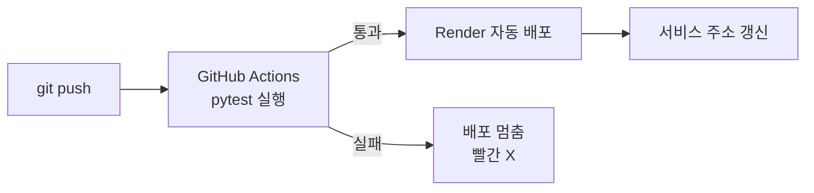
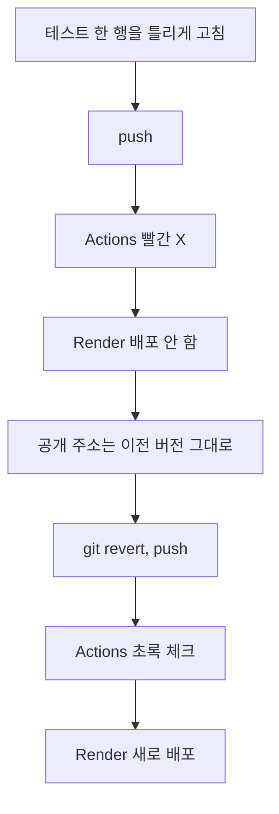
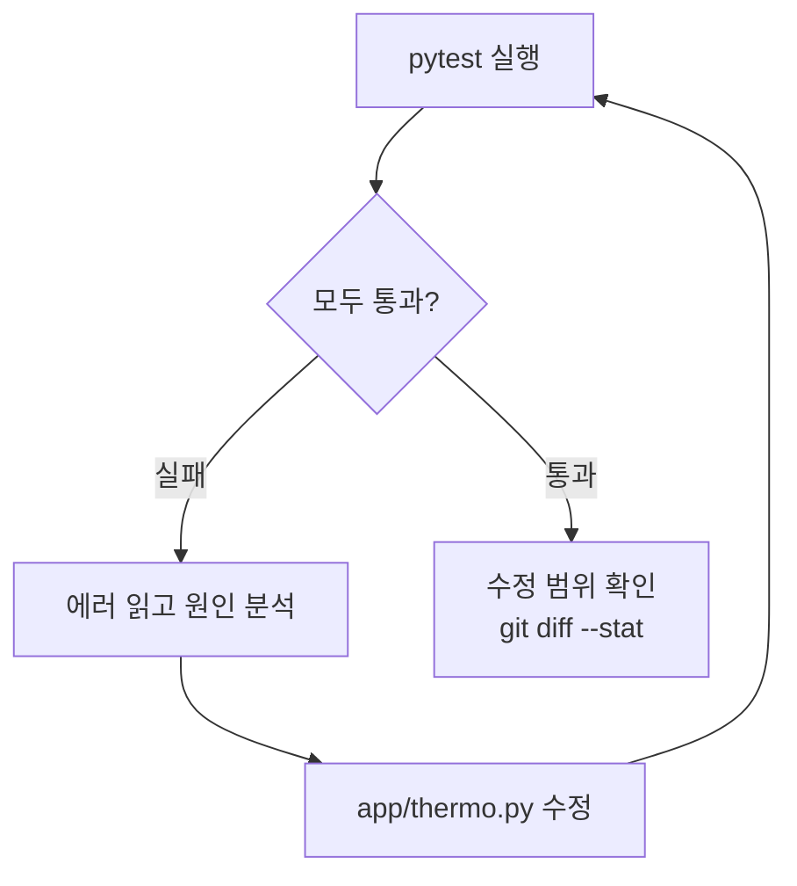

# 세션 3 — 배포

이 문서는 세션 3의 진행 순서입니다. push 하면 테스트가 자동으로 돌고, 통과한 코드만 인터넷에 배포되게 만듭니다.

출발점 맞추기: 늦었으면 지금 맞추고 시작합니다. 이 세션의 브랜치는 `cp3-tdd`입니다(README 블록 ⑩).

```text
git fetch origin
git checkout origin/cp3-tdd -- .
```

그다음 commit 합니다.

오늘의 개념은 이렇습니다.

- CI: 코드를 올릴 때마다 로봇이 자동으로 테스트를 돌려 줍니다. 통과하면 초록 체크, 실패하면 빨간 X가 뜹니다.
- 배포: 내 컴퓨터에서만 되던 서비스를 인터넷 주소로 열어 줍니다.
- CD: 테스트를 통과하면 자동으로 배포합니다.
- 오늘은 둘을 이어서 "테스트를 통과한 코드만 배포"되게 만듭니다. 요청서 4장의 약속입니다.



세션 순서입니다.

| 순서 | 할 일 |
|---|---|
| 0 | CI 개념 듣기 |
| 1 | CI 파일 복사하고 push |
| 2 | Actions에서 초록 체크 확인 |
| 3 | Render 서비스 만들기 (계정은 세션 1에서 만들었습니다. 로그인합니다) |
| 4 | 배포된 화면 열기 |
| 5-1 | 일부러 테스트 깨뜨리기 → 빨간 X → 배포 안 됨 → 되돌리기 (강사 시연이 기본입니다. 여유가 있으면 직접 해 봅니다) |
| 5-2 | 일부러 코드 깨뜨리기 → agy가 스스로 고치게 하기 (자가 치유) |
| 6 | README에 주소 적기 |

> 안전 규칙
> - AI 채팅에 비밀번호, API 키, 실제 고객 정보, 회사 코드는 넣지 않습니다.
> - 결제 수단은 어디에도 등록하지 않습니다.
> - Render가 카드를 요구하면 멈추고 손을 듭니다. 무료(Free) 서비스는 카드가 필요 없습니다.

---

## 0. CI 개념

위 흐름을 강사 설명으로 듣습니다. 따라 칠 것은 없습니다.

- CI 파일(`deploy/ci.yml`)은 "push 하면 GitHub의 컴퓨터에서 `pytest -v`를 돌려라"는 지시서입니다. 이런 자동 실행 한 벌을 GitHub Actions 워크플로라고 합니다.
- 테스트를 모두 통과해야 초록 체크입니다. 하나라도 실패하면 빨간 X입니다.
- Render는 After CI Checks Pass 설정으로 초록 체크가 뜬 뒤에만 새로 배포합니다.
- 비밀값(키, 비밀번호)은 코드가 아니라 Render 환경 변수에 넣습니다.

---

## 1. CI 파일 복사하고 push

`deploy/ci.yml`은 강사가 미리 만들어 둔 완성 파일입니다. 읽지 않아도 됩니다. 하는 일은 하나입니다. GitHub에서 `pytest -v`를 돌립니다.

이 파일을 GitHub가 읽는 자리(`.github/workflows/`)로 복사합니다(README 블록 ⑫). 명령은 한 줄입니다.

macOS:

```bash
mkdir -p .github/workflows && cp deploy/ci.yml .github/workflows/ci.yml
```

Windows PowerShell:

```powershell
New-Item -ItemType Directory -Force .github\workflows; Copy-Item deploy\ci.yml .github\workflows\ci.yml
```

그다음 push 합니다(README 블록 ⑨와 같은 순서입니다).

```text
git add .github
git commit -m "CI 추가"
git push
```

### 막혔을 때

복사 명령이 안 되면 완성본을 가져옵니다(README 블록 ⑩).

```text
git fetch origin
git checkout origin/cp4-ship -- .
```

---

## 2. Actions에서 초록 체크 확인

1. 내 GitHub 저장소 화면에서 위쪽 Actions 탭을 엽니다.
2. 방금 올린 commit 이름(`CI 추가`) 줄을 누릅니다.
3. 노란 동그라미(진행 중)가 초록 체크로 바뀔 때까지 기다립니다.
4. 안으로 들어가 테스트 단계를 펼칩니다. 내 컴퓨터에서 보던 `pytest -v` 결과와 같은 줄이 보입니다.

내 컴퓨터가 아니라 GitHub의 컴퓨터에서 돌았다는 점을 기억합니다.

### 확인 포인트

- [ ] Actions 탭에 초록 체크가 있다
- [ ] 테스트 단계 안에서 `passed`가 보인다

### 막혔을 때

- 빨간 X가 떴다면 테스트 단계를 펼쳐 `FAILED` 줄을 찾아 강사에게 보여 줍니다. 세션 2의 `app/thermo.py`가 덜 끝났을 가능성이 큽니다.
- 따라잡기: `git checkout origin/cp3-tdd -- .` 후 다시 commit, push 합니다(README 블록 ⑩).

---

## 3. Render 서비스 만들기

> Render 로그인이 막히거나, 서비스 만들기가 계속 막히거나, 결제 수단을 요구하거나, 빌드가 두 번 연속 실패하면 [Vercel로 배포하기](03-vercel.md)로 바꿉니다. 코드는 그대로입니다.

Render는 코드를 받아 인터넷 서버에서 돌려 주는 서비스입니다. 화면 이름은 조금 다를 수 있습니다.

1. render.com에서 로그인합니다. 세션 1에서 GitHub로 가입해 만든 계정입니다. 계정이 없으면 Sign up with GitHub로 지금 가입합니다. 결제 수단은 넣지 않습니다.
2. New → Web Service를 누르고 내 `review-thermo` 저장소를 연결합니다. GitHub 권한을 묻는 화면이 나오면 이 저장소만 허용합니다.
3. 아래처럼 입력합니다. Build와 Start 값은 README 블록 ⑮에서 복사합니다.

| 칸 | 값 |
|---|---|
| Name | 아무 이름 (예: `내이름-review-thermo`) |
| Branch | `main` |
| Build Command | `pip install -r requirements.txt` |
| Start Command | `uvicorn app.main:app --host 0.0.0.0 --port $PORT` |
| Instance Type | Free |
| Environment Variables | 이름 `MODEL_REPO`, 값은 강사가 알려 준 값 (Render 설정 화면에서만 입력합니다) |

4. Create Web Service를 누릅니다. 첫 빌드가 끝날 때까지 로그가 흘러가는 것을 봅니다.
5. 서비스 화면의 Settings에서 Auto-Deploy 항목을 찾아 After CI Checks Pass로 바꿉니다. 이 항목이 안 보이면 강사를 부릅니다. 대신 쓸 방법이 있습니다.

After CI Checks Pass의 뜻: GitHub Actions 테스트가 초록 체크가 된 뒤에만 Render가 새로 배포합니다.

> 비밀값은 코드에 쓰지 않습니다.
> API 키나 비밀번호를 코드에 적어 push 하면 저장소에 그대로 남습니다. 비밀값은 Render 환경 변수나 GitHub Secrets에 넣습니다. 방금 입력한 `MODEL_REPO`가 환경 변수의 예입니다. `MODEL_REPO` 자체는 비밀이 아니지만, 코드 밖에서 값을 넣는 방법은 같습니다.

### 확인 포인트

- [ ] 서비스 로그에 `Your service is live` 같은 문구가 보인다 (정확한 문구는 다를 수 있습니다)
- [ ] Settings의 Auto-Deploy가 After CI Checks Pass이다
- [ ] 서비스 이름 아래에 `https://....onrender.com` 주소가 보인다
- [ ] `MODEL_REPO`를 코드가 아니라 Render 환경 변수에 넣었다는 것을 말할 수 있다

### 막혔을 때

- 배포가 실패하면 로그의 빨간 줄을 강사에게 보여 줍니다.
- Build와 Start 명령은 한 글자만 틀려도 실패합니다. 위 표와 한 글자씩 비교합니다.

---

## 4. 배포된 화면 열기

1. 서비스 주소(`https://....onrender.com`)를 브라우저에서 엽니다. 내 컴퓨터가 꺼져 있어도, 옆 사람 폰에서도 열립니다.
2. 리뷰를 넣고 분석을 누릅니다.
3. 처음 누를 때는 느립니다. 모델을 내려받는 중이기 때문입니다. 한 번 되면 빨라집니다.

> Free 서버는 15분 동안 아무도 안 쓰면 잠듭니다. 잠든 뒤 처음 열면 다시 느립니다. 고장이 아닙니다.

`https://....onrender.com/health`를 열어 `{"status":"ok"}`가 보이는지도 확인합니다.

### 확인 포인트

- [ ] 배포된 주소에서 분석 결과(온도계)가 나온다
- [ ] `/health`에서 `ok`가 보인다

### 막혔을 때

- 화면에 503이 나오면 Render의 `MODEL_REPO` 값(모델 저장소 이름)이 맞는지 확인하고 강사에게 알립니다. Environment 화면에서 고치면 다시 배포됩니다. `MODEL_REPO`는 내 PC가 아니라 Render 서비스 설정에서만 입력합니다.
- 오래 안 열리면 한 번 더 기다렸다가 강사를 부릅니다.

---

## 5. 일부러 깨뜨려 보기

### 5-1. 테스트 깨뜨리기

강사가 먼저 한 번 깨뜨려 보여 줍니다. 여유가 있으면 아래 순서로 직접 해 봅니다. "테스트를 통과한 코드만 배포된다"를 눈으로 확인합니다.

1. VS Code에서 `tests/test_thermo.py`를 엽니다.
2. 예시 행 하나만 일부러 틀리게 고칩니다. 손으로 한 곳만 바꿉니다.

```text
(0.9, "positive"),   →   (0.9, "negative"),
```

내 파일에 이 행이 없으면 `assert` 줄의 기대값 하나(`"positive"` 또는 `"negative"`)를 반대로 바꿉니다.

3. 로컬에서 먼저 봅니다. `pytest -v`에 `FAILED`가 한 줄 생깁니다.
4. push 합니다.

```text
git add tests/test_thermo.py
git commit -m "일부러 테스트 깨뜨리기"
git push
```

5. GitHub Actions 탭에서 빨간 X를 확인합니다.
6. Render 서비스의 Events(또는 Deploys) 화면을 봅니다. 이 commit은 배포가 시작되지 않거나 건너뛴 것으로 보여야 합니다. 표시 문구는 화면에 따라 다를 수 있습니다.
7. 배포된 주소는 아직 멀쩡히 열립니다. 깨진 코드가 인터넷에 나가지 않았습니다.

이제 되돌립니다(README 블록 ⑬). `git revert`는 방금 한 commit을 취소하는 새 commit을 만듭니다. 되돌린 뒤에는 `git push`를 한 번 더 해야 GitHub와 Render에 반영됩니다.

```text
git revert HEAD --no-edit
git push
```

Actions가 다시 초록 체크가 되고 Render가 새로 배포되는지 확인합니다.



#### 확인 포인트

- [ ] 깨뜨린 commit에서 Actions가 빨간 X였다
- [ ] Render가 그 commit을 배포하지 않았다
- [ ] 되돌린 뒤 Actions가 다시 초록 체크다

#### 막혔을 때

- `git revert` 중 편집 화면이 뜨면 저장하고 닫습니다.
- 꼬였다면 `git fetch origin` 후 `git checkout origin/cp4-ship -- .`로 완성본 상태로 돌아갑니다. 그다음 commit, push 합니다.
- Render가 빨간 X인데도 배포했다면 Auto-Deploy 설정이 다른 것입니다. 강사를 부릅니다. 대안으로 강사가 Deploy Hook 방법을 설명합니다.

### 5-2. 코드를 깨뜨리고 AI가 스스로 고치게 하기 (자가 치유)

5-1은 테스트를 깼습니다. 이번에는 코드(`app/thermo.py`)를 깹니다. 그리고 AI에게 "테스트를 돌려 보고, 실패하면 스스로 고쳐"라고 맡깁니다.

AI가 실행 → 실패 확인 → 원인 분석 → 수정 → 다시 실행을 스스로 반복하는 것을 자가 치유(Self-Healing)라고 합니다. 이 반복은 테스트가 있어서 가능합니다. 테스트가 없으면 AI는 고쳤는지 알 수 없습니다.



이 실습은 push 하지 않습니다. 내 컴퓨터에서만 합니다.

1. 5-1을 되돌린 상태에서 시작합니다. `git status`에 바뀐 파일이 없고, `pytest -v`가 전부 PASSED여야 합니다.
2. `app/thermo.py`를 열고 `to_label` 안에서 0.5를 비교하는 곳을 한 군데만 틀리게 바꿉니다. 예: `>=`를 `>`로. (`<`를 `<=`로 바꿔도 됩니다)
3. `pytest -v`를 실행해 FAILED를 확인합니다. 0.5 경계값 행이 실패합니다(`1 failed, 20 passed`).
4. 터미널에서 `agy`를 켜고 아래처럼 맡깁니다.

```text
pytest -v 를 돌리고, 실패하면 원인을 찾아 고친 뒤 다시 돌려. 통과할 때까지 반복해. tests/ 와 SPEC.md 는 고치지 마.
```

5. agy가 일하는 모습을 지켜봅니다. 순서대로 나오는지 봅니다: 테스트 실행 → 실패 확인 → 원인 찾기 → 파일 수정 → 다시 실행.
6. 명령 실행을 허락할지 물으면 명령 한 줄을 읽습니다. `pytest`, `git diff`, `git status`만 허락합니다. 나머지는 거절합니다.
7. 끝나면 직접 `pytest -v`를 실행합니다. 전부 PASSED여야 합니다.
8. 수정 범위를 확인합니다(README 블록 ⑧). 원래대로 돌아갔다면 `git diff --stat`에 아무것도 안 나옵니다. 나온다면 `app/thermo.py`뿐이어야 합니다. `tests/`나 `SPEC.md`가 나오면 AI가 테스트를 바꿔서 통과시킨 것입니다. `git restore tests/ SPEC.md`로 되돌립니다.

Copilot Agent 모드로도 같은 부탁을 보낼 수 있습니다. 그때는 2번부터 다시 시작합니다.

AI에게 "무엇이 문제였고 어떻게 고쳤는지 두 줄로 설명해 줘"라고 묻고, 내가 본 것과 같은지 비교합니다.

#### 확인 포인트

- [ ] 일부러 깨뜨린 뒤 `pytest -v`에서 FAILED를 봤다
- [ ] AI가 테스트 실행, 원인 분석, 수정, 다시 실행을 스스로 하는 것을 봤다
- [ ] 끝난 뒤 `pytest -v`가 전부 PASSED다
- [ ] 수정 범위 확인에서 `tests/`와 `SPEC.md`는 바뀌지 않았다

#### 막혔을 때

- 5번에서 agy가 파일을 고치지 않고 설명만 하면 "고쳐도 돼. 설명만 하지 말고 고쳐 줘"라고 덧붙입니다.
- 계속 안 풀리면 `git restore app/thermo.py`로 깨뜨리기 전으로 돌아갑니다.

---

## 6. README에 주소 적기

`README.md` 맨 아래 `배포 URL:` 칸에 내 서비스 주소를 적습니다.

```text
- 배포 URL: https://내서비스.onrender.com
```

```text
git add README.md
git commit -m "README에 배포 주소 추가"
git push
```

### 마무리 확인

- [ ] push 하면 테스트 → 배포가 자동으로 이어지고, 깨진 코드는 배포되지 않는다
- [ ] 비밀값(키, 비밀번호)은 코드가 아니라 Render 환경 변수나 GitHub Secrets에 넣는다
