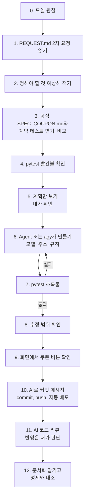
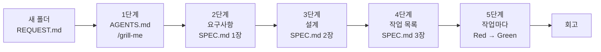
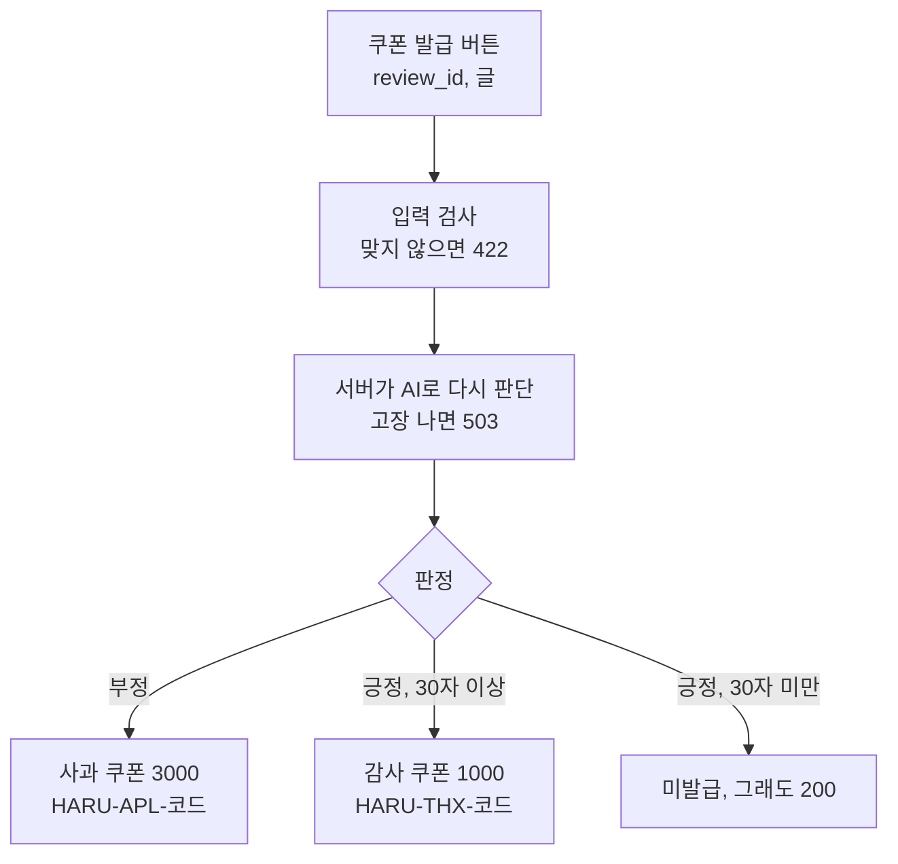

# 세션 4 — 4-1 쿠폰 API, 4-2 새 프로젝트를 명세부터

이 문서는 세션 4의 진행 순서입니다. 세션 4는 두 부분입니다.

- 4-1: 코드 뼈대 없이 API 명세서(약속)만 보고 AI와 쿠폰 기능을 만들고, 배포합니다. (1~9절)
- 4-2: 빈 폴더에서 새 프로젝트를 시작합니다. 이번에는 명세도 없습니다. agy의 질문에 답하며 `AGENTS.md`와 `SPEC.md`를 처음부터 만들고, 테스트를 먼저 쓰며 구현합니다. (10~15절)

출발점 맞추기: 늦었으면 지금 맞추고 시작합니다. 이 세션의 브랜치는 `cp4-ship`입니다(README 블록 ⑩).

```text
git fetch origin
git checkout origin/cp4-ship -- .
```

그다음 commit 합니다.

오늘의 개념은 이렇습니다.

- 세션 2에서는 함수 뼈대가 있었습니다. 오늘은 뼈대가 없습니다. 명세서 한 장이 전부입니다.
- API 명세서는 바깥에서 보이는 약속만 적습니다. 주소, 요청, 응답, 규칙, 오류 번호입니다. 파일을 어떻게 나눌지는 적지 않습니다.
- 약속을 지켰는지는 계약 테스트가 잽니다. 계약 테스트는 HTTP 요청을 보내고 응답만 봅니다.
- 화면(`static/`)은 이미 이 API를 부릅니다. 그래서 명세는 화면과 서버가 맺는 약속입니다.
- AI가 쓴 코드도 내가 설명할 수 있을 때 내 코드입니다.

> 안전 규칙
> - AI 채팅에 비밀번호, API 키, 실제 고객 정보, 회사 코드는 넣지 않습니다.
> - 결제 수단은 어디에도 등록하지 않습니다.

AI 도구는 Copilot과 agy 중 편한 쪽을 씁니다. 4-2는 agy를 씁니다. 4-1 흐름은 이렇습니다.



4-2 흐름입니다. 단계마다 내가 읽고 "승인"해야 다음 단계로 넘어갑니다.



---

## 1. AI 모델 관찰하기

출시했다고 끝이 아닙니다. 출시한 뒤에도 고리는 돕니다.

Launch(출시) → Observe(관찰) → Evaluate(평가) → Improve(개선) → 고친 서비스를 다시 출시

이것은 LLMOps(AI 서비스 운영)의 기본 고리입니다. 세션 3에서 Launch를 했습니다. 지금은 Observe부터 Improve까지 코딩 없이 해 봅니다.

화면(내 컴퓨터 `http://localhost:8000` 또는 배포 주소)에서 샘플 리뷰 30개를 하나씩 눌러 봅니다. 내 컴퓨터에서는 `uvicorn app.main:app --reload`로 켭니다(README 블록 ⑥). `MODEL_REPO`는 입력하지 않습니다. 화면에 503이 뜨면 강사에게 알립니다(모델 저장소 이름 확인).

1. Observe(관찰): 짝과 나눠서 보며 AI가 틀린 것 같은 리뷰를 찾습니다. 공책에 리뷰 앞부분 / 내가 보기엔 / AI 판단 / 왜 틀렸을까를 적습니다.
2. Evaluate(평가): 내가 본 리뷰 중 AI가 맞힌 것이 몇 건인지 셉니다. 예: 15건 중 12건
3. Improve(개선): 틀린 이유를 보고 고칠 아이디어를 한 줄 적습니다. 예: 반어법은 별점과 함께 보게 한다

힌트: 이 AI 모델은 영화 리뷰로 배웠습니다. 쇼핑 리뷰의 말투, 비꼬는 말("참 빨리도 오네요"), 이모지는 낯설 수 있습니다.

그래서 쿠폰 규칙을 AI에게만 맡기면 안 됩니다. 누구에게 쿠폰을 줄지는 명세로 정합니다. 테스트에서는 가짜 점수로 규칙만 확인합니다.

화면에서 분석을 누른 뒤 쿠폰 발급 버튼도 눌러 봅니다. 지금은 "쿠폰 API가 아직 없어요" 안내가 나옵니다. 화면은 쿠폰 API를 부르려고 하는데, 서버에 아직 없다는 뜻입니다. 정상입니다.

### 확인 포인트

- [ ] 틀린 것 같은 리뷰를 2개 이상 찾고 이유를 한 줄로 말할 수 있다
- [ ] 몇 건 맞았는지 세었고, 고칠 아이디어를 한 줄 적었다
- [ ] 쿠폰 버튼을 누르면 "쿠폰 API가 아직 없어요"가 나온다

---

## 2. 2차 요청 읽고 정해야 할 것 예상하기

`REQUEST.md` 3장(2차 요청)을 읽습니다. 쿠폰을 사과, 감사, 중복 방지로 나눠 말하고 있습니다. 애매한 곳이 많습니다.

- 얼마를 줄까?
- 몇 자부터 "정성"일까?
- 쿠폰 코드는 어떻게 만들까?
- 요청에는 무엇을 담고, 응답에는 무엇을 담을까?

이번에는 AI와 명세 초안을 쓰지 않습니다. 명세를 처음부터 쓰는 연습은 4-2에서 합니다. 짝과 이야기해서 내 예상만 워크북 4-2 표의 "내 예상" 칸에 적습니다.

### 확인 포인트

- [ ] 금액, "정성" 기준(글자 수), 중복 방지 방법을 내 예상으로 적었다

---

## 3. 공식 API 명세와 계약 테스트 받기

강사의 공식 API 명세와 계약 테스트를 가져옵니다(README 블록 ⑭).

```text
git fetch origin
git checkout origin/cp5-coupon-spec -- SPEC_COUPON.md tests/test_api_coupon.py
```

내 예상과 `SPEC_COUPON.md`를 비교합니다.

| 비교할 것 | 공식 명세 |
|---|---|
| 주소 | `POST /v1/coupons/issue` |
| 요청 | `review_id`(1~20자), `text`(1~500자) |
| 응답 | `issued`, `coupon_type`, `amount`, `code`. 미발급이면 나머지는 null |
| 사과 쿠폰 | 부정이면 3000, 코드 `HARU-APL-` + 대문자 ID |
| 감사 쿠폰 | 긍정이고 앞뒤 공백을 뺀 글이 30자 이상이면 1000, 코드 `HARU-THX-` + 대문자 ID |
| 오류 번호 | 입력 오류 422, AI 부품 오류 503 |

우리가 정하지 못한 것은 무엇인지도 찾습니다. 이후 작업은 공식 `SPEC_COUPON.md`를 따릅니다.

`tests/test_api_coupon.py`는 계약 테스트입니다. 코드는 읽지 않아도 됩니다. 파일 안의 테스트 이름과 설명만 훑어봅니다. 서버에 요청을 보내고 번호와 응답만 확인합니다.

저장해 둡니다. 뒤의 수정 범위 확인에서 "내가 만든 것만" 보이게 하려는 것입니다.

```text
git add .
git commit -m "쿠폰 API 명세와 계약 테스트 추가"
```

### 빨간불 확인

```text
pytest -v
```

`tests/test_api_coupon.py`의 테스트 6개가 FAILED(Red)로 보입니다. 맨 아래 줄은 `6 failed, 21 passed`입니다.

실패 이유를 한 줄 봅니다. `assert 405 == 200`처럼 나옵니다. 405는 "이 주소에는 이 방식(POST)을 받는 곳이 없다"는 번호입니다. 쿠폰 API가 아직 없으니 정상입니다. 오늘의 목표는 이 6개를 초록으로 만드는 것입니다.

세션 2와 다른 점이 있습니다. 그때는 `NotImplementedError`가 보였습니다. 함수 뼈대는 있었기 때문입니다. 오늘은 뼈대 자체가 없습니다.

### 막혔을 때

위 두 명령(`git fetch origin`과 `git checkout origin/cp5-coupon-spec -- ...`)을 다시 실행합니다.

---

## 4. 계획만 먼저 보기

바로 만들게 하지 않습니다. 먼저 AI가 무엇을 어느 파일에 만들지 계획만 보여 달라고 합니다. Copilot의 Plan 모드를 쓰거나, Ask 모드(또는 agy)에서 이렇게 보냅니다. Plan 모드는 버전에 따라 안 보일 수 있습니다.

```text
AGENTS.md 와 SPEC_COUPON.md 를 읽고, SPEC_COUPON.md 만 보고 쿠폰 API를 만들려면 무엇을 어느 파일에 만들지 계획만 보여 줘. 코드는 쓰지 마. 파일도 고치지 마.
```

계획을 읽고 확인합니다.

- [ ] 요청 모양과 응답 모양(Pydantic 모델)을 어디에 만들지 적혀 있다
- [ ] 주소(라우트)를 어디에 만들지 적혀 있다
- [ ] 규칙 함수를 어디에 만들지 적혀 있다
- [ ] 바꾸는 파일이 `app/` 안에 있다
- [ ] `tests/`, `SPEC_COUPON.md`, `static/`를 고친다는 말이 없다
- [ ] AI 부품을 `app/deps.py`의 `get_predict`로 받는다고 적혀 있다

용어를 한 번 풀어 둡니다.

| 말 | 뜻 |
|---|---|
| Pydantic 모델 | 요청과 응답의 모양과 규칙을 적어 두는 파이썬 클래스. `app/schemas.py`의 `AnalyzeRequest`가 예입니다 |
| 라우트 | 주소 하나를 맡는 함수. `app/main.py`의 `/v1/reviews/analyze`가 예입니다 |
| 규칙 함수 | "부정이면 사과 쿠폰" 같은 규칙만 계산하는 함수 |

빠진 것이 있거나 `tests/`를 고친다는 말이 있으면 멈춥니다. "하지 말 것"을 더 분명히 써서 다시 부탁합니다.

---

## 5. 만들기와 초록불

### 5-1. AI에게 만들게 하기

Copilot Agent 모드 또는 agy로 보냅니다. 이 세션의 첫 Agent 요청입니다.

> Agent가 명령 실행 승인을 물으면 명령 한 줄을 읽고 `pytest`, `git status`, `git diff` 류만 허용합니다. 나머지와 삭제 명령은 거절합니다. '항상 허용'은 누르지 않습니다.

```text
[원하는 것] SPEC_COUPON.md 의 쿠폰 API를 만들어 줘. AGENTS.md 와 SPEC_COUPON.md 를 먼저 읽어.
[방법 힌트] 방금 본 계획대로 해 줘. Pydantic 모델(요청, 응답) → 라우트 → 규칙 함수 순서로 만들어. AI 부품은 app/deps.py 의 get_predict 를 Depends 로 받아 써.
[하지 말 것] SPEC_COUPON.md 와 tests/ 는 건드리지 마. static/ 와 app/sentiment.py, app/deps.py 도 고치지 마. 테스트 값을 코드에 그대로 박지 마.
[완료 기준] pytest -v 를 실행해서 통과 개수와 실패 개수, 바꾼 파일 목록을 알려 줘.
```

### 5-2. 초록불 확인

내가 직접 실행합니다. AI의 말만 믿지 않습니다.

```text
pytest -v
```

- [ ] 맨 아래 줄에 `failed`가 없다 (`27 passed`. AI가 테스트를 더 만들었다면 숫자가 더 큽니다)
- [ ] `tests/test_api_coupon.py`의 6개가 모두 PASSED다

실패하면 이렇게 합니다.

1. `FAILED` 줄과 그 아래 에러 메시지를 복사합니다.
2. 아무것도 고치지 않고 AI에게 그대로 붙여 줍니다.
3. 아래처럼 부탁합니다.

```text
pytest 가 아래처럼 실패했어. 원인을 찾아서 고쳐 줘. SPEC_COUPON.md 와 tests/ 는 건드리지 마. 고친 뒤 pytest -v 를 다시 실행해서 결과를 알려 줘.
(여기에 FAILED 줄과 에러 메시지를 붙여 넣기)
```

### 막혔을 때

같은 실패가 두 번 반복되면 새 대화를 열고 `AGENTS.md`와 `SPEC_COUPON.md`를 붙여서 처음부터 다시 설명합니다. 그래도 안 되면 완성본의 쿠폰 코드를 가져옵니다. 내 `app/` 파일이 덮어써집니다.

```text
git fetch origin
git checkout origin/final -- app/
```

전체를 따라잡으려면 `git checkout origin/final -- .`입니다.

---

## 6. 수정 범위 확인과 화면 확인

### 6-1. 수정 범위 확인

AI가 고쳐도 되는 파일(`app/`)만 고쳤는지 봅니다. `tests/`나 `SPEC_COUPON.md`가 바뀌었다면 테스트 기대값을 바꿔서 통과시켰을 수 있습니다.

```text
git diff --stat
git status
```

README 블록 ⑯에 같은 명령이 있습니다. `notes/MY_WORKBOOK.md`가 같이 보여도 괜찮습니다. 내 워크북입니다.

- [ ] `git diff --stat`에 `app/main.py`, `app/schemas.py` 같은 `app/` 파일만 나온다
- [ ] `git status`의 새 파일도 `app/` 안에 있다 (예: `app/coupon.py`)
- [ ] `tests/`, `SPEC_COUPON.md`, `static/`는 나오지 않는다

`tests/`나 `SPEC_COUPON.md`가 나오면 되돌립니다.

```text
git restore tests/ SPEC_COUPON.md
```

그다음 "하지 말 것" 칸을 더 분명히 써서 다시 시킵니다.

### 6-2. 화면에서 쿠폰 버튼 확인

서버를 켭니다(README 블록 ⑥). 이미 켜 놓았다면 `--reload` 덕분에 자동으로 다시 시작됩니다.

1. `http://localhost:8000`에서 불만 리뷰를 고르고 분석을 누릅니다.
2. 쿠폰 발급을 누릅니다. 사과 쿠폰이 나오고 코드가 `HARU-APL-`로 시작합니다.
3. 같은 리뷰로 한 번 더 누릅니다. 코드가 똑같이 나옵니다.
4. 칭찬 리뷰도 눌러 봅니다. 글이 30자 이상이면 감사 쿠폰, 짧으면 "쿠폰 대상이 아니에요"가 나옵니다.

같은 요청을 몇 번 해도 결과가 같은 성질을 멱등성이라고 합니다. 같은 리뷰는 늘 같은 코드가 나오므로 쿠폰이 두 번 나가지 않습니다.

쿠폰 요청이 지나가는 길은 이렇습니다.



### 확인 포인트

- [ ] 불만 리뷰에서 사과 쿠폰(코드가 `HARU-APL-`로 시작)이 나온다
- [ ] 같은 리뷰를 두 번 눌러도 같은 코드가 나온다
- [ ] 수정 범위 확인에서 `tests/`와 `SPEC_COUPON.md`가 나오지 않았다

---

## 7. AI로 커밋 메시지 만들고 배포하기

commit 메시지도 AI에게 초안을 부탁합니다. 새 파일은 `git add` 뒤에야 변경 내용에 보이므로 먼저 `git add .`를 합니다.

```text
git add .
```

초안을 만드는 방법은 두 가지입니다.

- Copilot: VS Code 왼쪽 소스 제어 화면의 메시지 입력칸 옆 반짝이 버튼(✨)을 누릅니다. 메시지 초안이 채워집니다.
- agy: 아래처럼 부탁합니다. 명령 실행 허락을 물으면 `git diff`만 허락합니다.

```text
git diff --staged 를 보고 커밋 메시지를 한 줄로 써 줘.
```

버튼 모양은 버전에 따라 다를 수 있습니다. 버튼이 안 보이면 터미널에서 `git diff --staged`를 실행하고, 나온 글을 채팅에 붙여 넣어 같은 부탁을 합니다.

AI의 메시지를 그대로 쓰지 않고 내가 읽고 고칩니다. 무엇을 바꿨는지 내가 설명할 수 있는 말이어야 합니다. 그다음 commit, push 합니다(README 블록 ⑨). `git add .`는 이미 했으니 아래 두 줄만 하면 됩니다.

```text
git commit -m "내가 고친 메시지"
git push
```

1. Actions에서 초록 체크를 기다립니다.
2. Render가 자동으로 다시 배포합니다. Events에서 새 배포를 확인합니다.
3. 배포 주소 화면에서 분석 → 쿠폰 발급을 눌러 봅니다. 같은 리뷰로 한 번 더 누릅니다.

### 확인 포인트

- [ ] commit 메시지를 내가 읽고 고친 뒤 commit 했다
- [ ] Actions가 초록 체크다
- [ ] 배포 주소에서 같은 리뷰의 쿠폰 코드가 두 번 똑같이 나온다

---

## 8. AI 코드 리뷰

AI에게 방금 만든 변경을 리뷰해 달라고 합니다. 리뷰는 의견입니다. 고칠지 말지는 내가 정합니다.

Copilot Chat에 `#changes`를 붙여 보냅니다. `#changes`는 아직 commit 하지 않은 변경을 가리킵니다. 이미 commit 했다면 비어 있을 수 있습니다. 그때는 바뀐 파일(`app/main.py`, `app/schemas.py`, 새 파일)을 채팅에 끌어놓습니다.

```text
#changes 이 변경을 리뷰해 줘. 버그, 명세와 다른 점, 빠진 테스트만 알려 줘. 코드는 고치지 마.
```

agy에는 같은 부탁을 이렇게 보냅니다.

```text
방금 한 commit(git show HEAD)을 리뷰해 줘. 버그, 명세와 다른 점, 빠진 테스트만 알려 줘. 파일은 고치지 마.
```

`#changes` 문법은 버전에 따라 다를 수 있습니다. 안 되면 `git show HEAD` 결과를 채팅에 붙여 넣습니다.

1. 지적을 하나씩 읽습니다.
2. `SPEC_COUPON.md`와 대조합니다. 명세에 없는 지적이면 무시해도 됩니다.
3. 고칠 가치가 있는 지적 하나를 고릅니다.
4. 고치기로 했다면 AI에게 그 한 가지만 부탁합니다. 하지 말 것은 같습니다.
5. 고친 뒤 `pytest -v`, 수정 범위 확인(README 블록 ⑯), commit, push 순서를 다시 합니다.

### 확인 포인트

- [ ] 리뷰 지적 중 하나를 골라 반영할지 내가 판단했다
- [ ] 반영하지 않기로 했다면 이유를 한 줄 적었다

---

## 9. 문서화 맡기기 (선택)

README에 쿠폰 API 사용법을 AI가 쓰게 합니다. 쓴 글이 맞는지는 내가 명세와 대조합니다.

Copilot Agent 또는 agy로 보냅니다.

```text
[원하는 것] README.md 맨 아래에 "쿠폰 API 사용법" 절을 추가해 줘. 요청 예시와 응답 예시를 넣어 줘.
[방법 힌트] SPEC_COUPON.md 를 보고 써. 사과 쿠폰, 감사 쿠폰, 미발급 예시를 하나씩 넣어 줘.
[하지 말 것] README.md 의 기존 내용은 고치지 마. SPEC_COUPON.md 와 tests/ 와 app/ 는 건드리지 마.
[완료 기준] 바뀐 파일은 README.md 하나야. 추가한 절의 예시가 SPEC_COUPON.md 와 같은지 스스로 확인해서 알려 줘.
```

내가 확인합니다.

- [ ] `git diff --stat`에 `README.md`만 나온다
- [ ] 요청 JSON의 필드 이름이 명세와 같다 (`review_id`, `text`)
- [ ] 응답 JSON의 필드 이름이 명세와 같다 (`issued`, `coupon_type`, `amount`, `code`)
- [ ] 금액과 코드 예시가 명세와 같다 (3000 / `HARU-APL-R2`, 1000 / `HARU-THX-R7`)
- [ ] 명세에 없는 내용을 AI가 지어내지 않았다

다르면 어디가 다른지 알려 주고 고치게 합니다. 맞으면 commit, push 합니다(README 블록 ⑨).

---

## 10. 4-2 시작: 새 폴더 만들기

4-2는 SDD·TDD 실습입니다. 오늘 배운 순서를 처음부터 혼자 돌아 봅니다. 이번에는 `AGENTS.md`도 `SPEC.md`도 없습니다. 둘 다 내가 만듭니다.

- 요청서는 하루마켓 CS팀의 3차 요청 [docs/04-cleanbot-request.md](04-cleanbot-request.md)입니다. 리뷰 속 전화번호·이메일 가리기, 욕설과 너무 짧은 리뷰 막기입니다.
- agy의 `/grill-me`가 나를 인터뷰합니다. 내가 정하지 않은 것을 AI가 질문으로 찾아 줍니다. 답은 내가 정합니다.
- 다섯 단계로 나눕니다. 작업 규칙(`AGENTS.md`) → 요구사항(`SPEC.md` 1장) → 설계(2장) → 작업 목록(3장) → 작업마다 Red → Green.
- 단계마다 AI가 초안을 보여 주면 내가 읽고 확인합니다. 맞으면 "승인"이라고 쓰고, 그때 파일로 저장합니다. 틀리면 고칠 점을 말합니다.

| 단계 | 만드는 것 | 내가 확인할 것 |
|---|---|---|
| 1 | `AGENTS.md` | 일곱 칸이 다 있고, "테스트 먼저", "기대값 바꾸지 않기"가 있다 |
| 2 | `SPEC.md` 1장 요구사항 | 문장마다 예시표가 있고, 경계값 행이 있다 |
| 3 | `SPEC.md` 2장 설계 | 요구사항 번호마다 맡는 함수가 있다 |
| 4 | `SPEC.md` 3장 작업 목록 | 작업 하나 = 함수 하나, 체크박스로 되어 있다 |
| 5 | `tests/`, `cleanbot.py` | 작업마다 빨간불을 먼저 보고 초록불을 만든다 |

review-thermo 터미널에서 서버(`Ctrl+C`)와 agy(`Ctrl+C`)를 끄고, 가상환경도 끕니다(`deactivate`). 그다음 review-thermo 옆에 새 폴더를 만듭니다(README 블록 ⑰).

macOS:

```bash
cd ..
mkdir review-cleanbot && cd review-cleanbot
cp ../review-thermo/docs/04-cleanbot-request.md REQUEST.md
python3 -m venv .venv
source .venv/bin/activate
pip install pytest
mkdir tests
git init
code -r .
```

Windows PowerShell:

```powershell
cd ..
mkdir review-cleanbot; cd review-cleanbot
copy ..\review-thermo\docs\04-cleanbot-request.md REQUEST.md
python -m venv .venv
.venv\Scripts\Activate.ps1
pip install pytest
mkdir tests
git init
code -r .
```

VS Code가 새 폴더로 다시 열립니다. 새 터미널을 열고 `(.venv)`가 보이지 않으면 가상환경을 다시 켭니다. 그다음 `agy`를 켭니다.

### 확인 포인트

- [ ] VS Code 탐색기에 `REQUEST.md`와 빈 `tests` 폴더가 보인다
- [ ] 터미널 앞에 `(.venv)`가 보이고, `agy`가 켜졌다

---

## 11. 1단계: AGENTS.md 인터뷰 받기

agy에 붙여 넣습니다.

```text
/grill-me REQUEST.md를 읽고 이 프로젝트의 AGENTS.md를 만들려고 해. 프로젝트 소개, 기준 문서, 만드는 파일, 실행 방법, 고치면 안 되는 파일, 일하는 방법, 끝났을 때 보고할 것을 정해야 해. 하나씩 물어봐 줘. 질문은 7개까지. 다 물어본 뒤 AGENTS.md 초안을 보여 주고, 내가 "승인"이라고 하면 저장해.
```

질문에 내 말로 답합니다. review-thermo의 `AGENTS.md`를 떠올리면 쉽습니다. 막히면 "추천 2개를 장단점과 함께 보여 줘"라고 해도 됩니다. 고르는 것은 나입니다.

초안을 읽고 확인합니다.

- [ ] 일곱 칸이 다 있다
- [ ] 테스트 실행 명령이 `python -m pytest -v`다
- [ ] 고치면 안 되는 파일에 `REQUEST.md`, `SPEC.md`, 내가 쓴 테스트가 있다
- [ ] "테스트를 먼저 쓴다", "테스트가 실패하면 기대값이 아니라 코드를 고친다"가 있다
- [ ] "리뷰를 저장하지 않는다", "새 패키지를 설치하지 않는다"가 있다

다 맞으면 `승인`이라고 씁니다. 빠진 것이 있으면 "○○을 넣어서 초안을 다시 보여 줘"라고 씁니다.

`/grill-me`가 안 보이면 같은 문장에서 `/grill-me`를 빼고 맨 앞에 "나를 인터뷰해 줘."를 붙입니다.

---

## 12. 2단계: 요구사항 인터뷰 받기 (SPEC.md 1장)

```text
/grill-me REQUEST.md와 AGENTS.md를 읽고 SPEC.md 1장 '요구사항'을 쓰려고 해. 내가 정해야 할 것을 하나씩 물어봐 줘. 질문은 7개까지. 요구사항은 R1, R2처럼 번호를 붙이고 "~하면, 시스템은 ~한다" 문장으로 써 줘. 요구사항마다 예시표(입력 → 결과)를 붙이고 경계값을 꼭 넣어 줘. 코드는 쓰지 마. 다 쓰면 보여 주고, 내가 "승인"이라고 하면 SPEC.md로 저장해.
```

AI가 물을 만한 것입니다. 미리 생각해 두면 답이 빠릅니다.

- 어떤 모양의 전화번호를 찾을까? (`010-1234-5678`, `01012345678`, 띄어쓰기)
- 가릴 때 어떻게 바꿀까? 전부? 가운데만?
- 금칙어는 무엇일까? (수업에서는 `바보`, `멍청이`처럼 순한 말로 정합니다)
- 몇 자 미만이 "너무 짧은" 리뷰일까? 앞뒤 공백은 셀까?
- 욕설도 있고 짧기도 하면 무엇을 먼저 알려 줄까?
- 결과는 무엇으로 돌려줄까? (예: `"ok"`, `"too_short"`, `"rejected"`)

초안을 읽고 확인합니다.

- [ ] 요구사항마다 "~하면, 시스템은 ~한다" 문장이 있다
- [ ] 요구사항마다 예시표가 있다
- [ ] 경계값 행이 있다 (예: 9자는 짧음, 10자는 통과)
- [ ] "잘", "적당히", "너무" 같은 말이 남아 있지 않다
- [ ] 요청서 4장 "아직 정하지 않은 것"이 모두 정해졌다

맞으면 `승인`이라고 씁니다.

---

## 13. 3·4단계: 설계와 작업 목록 (SPEC.md 2장, 3장)

설계를 부탁합니다.

```text
SPEC.md 1장을 보고 2장 '설계'를 써 줘. 파일 이름, 함수 이름, 입력과 출력, 함수마다 맡는 요구사항 번호를 표로 써 줘. 파이썬 표준 라이브러리만 써. 코드는 쓰지 마. 보여 주고 내가 "승인"이라고 하면 SPEC.md에 저장해.
```

- [ ] 요구사항 번호(R1, R2 …)가 표에 모두 한 번 이상 나온다
- [ ] 코드 파일이 하나(예: `cleanbot.py`)이고, 테스트 파일은 `tests/` 안에 있다

작업 목록을 부탁합니다.

```text
SPEC.md 1·2장을 보고 3장 '작업 목록'을 써 줘. 작업 하나는 함수 하나로, "- [ ]" 체크박스로 써 줘. 작업마다 옮길 예시표 행을 적어 줘. 코드는 쓰지 마. 보여 주고 내가 "승인"이라고 하면 SPEC.md에 저장해.
```

- [ ] 작업이 함수 수만큼 있고, 모두 `- [ ]`다
- [ ] 작업마다 옮길 예시표가 적혀 있다

명세가 완성됐습니다. 저장해 둡니다.

```text
git add .
git commit -m "AGENTS.md와 SPEC.md 작성"
```

---

## 14. 5단계: 작업 하나씩 TDD로

작업 1의 함수로 첫 테스트를 직접 씁니다. 내 `SPEC.md`에서 경계값 행 하나를 고릅니다. 새 파일 `tests/test_cleanbot.py`를 만들고 씁니다. 아래는 작업 1이 리뷰 판정 함수일 때의 예입니다. 함수 이름과 값은 내 `SPEC.md`를 따릅니다.

```python
from cleanbot import review_status


def test_nine_chars_is_too_short():
    assert review_status("열글자가딱되는리뷰") == "too_short"
```

```text
python -m pytest -v
```

`ModuleNotFoundError: No module named 'cleanbot'`처럼 실패하면 정상입니다. 아직 코드가 없습니다. 이것이 Red입니다. 이 폴더에서는 `pytest`만 치면 `cleanbot`을 못 찾을 수 있습니다. 꼭 `python -m pytest`로 칩니다.

agy에 부탁합니다.

```text
SPEC.md 3장의 작업 1만 해 줘. 먼저 작업 1의 예시표 나머지 행을 tests/test_cleanbot.py에 추가하고(내가 쓴 테스트는 바꾸지 마), python -m pytest -v로 빨간불을 보여 줘. 그다음 통과하는 가장 단순한 코드를 cleanbot.py에 써. 끝나면 작업 1 체크박스를 [x]로 바꾸고 passed/failed 개수를 알려 줘.
```

수정 범위를 확인하고 저장합니다.

```text
git diff --stat
git add .
git commit -m "작업 1 완료"
```

- [ ] `git diff --stat`에 `tests/test_cleanbot.py`, `cleanbot.py`, `SPEC.md`만 나온다
- [ ] `SPEC.md`에서 바뀐 곳은 체크박스 한 줄뿐이다
- [ ] 내가 쓴 첫 테스트가 그대로 있다

남은 작업은 같은 순서로 하나씩 합니다. 한 번에 맡기려면 `/goal`을 씁니다.

```text
/goal SPEC.md 3장의 남은 작업을 하나씩 끝내. 작업마다 테스트를 먼저 추가해서 빨간불을 보여 주고, 코드를 써서 초록불을 만들고, 체크박스를 [x]로 바꿔. SPEC.md의 1·2장과 내가 쓴 테스트는 고치지 마.
```

---

## 15. 다 됐는지 확인

- [ ] `python -m pytest -v`에 `failed`가 없다
- [ ] `SPEC.md` 3장의 체크박스가 모두 `[x]`다
- [ ] 요구사항 하나를 골라 예시표 행과 테스트 행을 한 줄씩 대조했다
- [ ] `git log --oneline`에 단계별 commit이 보인다

여유가 있으면 GitHub에 올립니다. GitHub에서 빈 Public 저장소 `review-cleanbot`을 만들고(README 체크 없이), 화면에 나오는 주소로 연결합니다.

```text
git branch -M main
git remote add origin https://github.com/<내아이디>/review-cleanbot.git
git push -u origin main
```

새 기능을 더하고 싶으면 코드보다 `SPEC.md`부터 고칩니다. 요구사항 → 예시표 → 작업 → 테스트 → 코드 순서입니다.

---


## 16. 시연, 이해 부채, 회고, 내일부터 쓰는 법

### 16-1. 시연

짝에게 내 배포 주소를 보여 줍니다. 분석 → 쿠폰 발급 순서로 보여 줍니다. 4-2의 `SPEC.md`와 `python -m pytest -v` 결과도 보여 줍니다.

### 16-2. 이해 부채 활동

AI가 쓴 코드를 이해하지 못한 채 쌓아 두면 나중에 고치지도 설명하지도 못합니다. 이것을 이해 부채라고 합니다.

> "다른 사람에게 정확히 설명할 수 없는 코드는 커밋하지 않는다." (Simon Willison, 2025년 3월)

1. 오늘 AI가 쓴 코드 중 하나를 고릅니다. 예: 쿠폰 규칙 함수, 4-2의 `cleanbot.py` 함수
2. Copilot 또는 agy에 보냅니다.

```text
이 함수를 처음 배우는 사람에게 3줄로 설명해 줘.
```

3. AI의 설명을 그대로 읽지 말고 내 말로 바꿔서 짝에게 설명합니다.

### 16-3. 회고

`docs/01-prompt-sheet.md`의 포스트모템 표를 채웁니다. 그리고 세 가지를 짝과 이야기합니다.

- 세션 2(함수 뼈대가 있던 날), 4-1(명세만 있던 날), 4-2(명세도 내가 만든 날)는 무엇이 달랐나?
- 4-2에서 AI가 던진 질문 중 내가 미처 생각하지 못한 것은?
- 명세가 없었다면 AI는 어디를 마음대로 정했을까?
- 리뷰에서 받은 지적 중 내가 받아들인 것과 버린 것은?

마지막으로 review-thermo 폴더의 agy에 `/learn`을 입력합니다. AI가 오늘의 잘된 점과 고친 점을 규칙이나 스킬로 정리하자고 제안하면, 읽어 보고 맞는 것만 `AGENTS.md`나 `.agents/skills/`에 남깁니다.

### 16-4. 내일부터 쓰는 법

- [ ] 일을 시키기 전에 무엇을 만들지 글로(명세, 예시표) 먼저 쓴다
- [ ] 프롬프트는 4칸으로 쓴다
- [ ] 만들기 전에 AI에게 계획만 보여 달라고 한다
- [ ] AI에게 "테스트와 명세는 건드리지 마"를 꼭 쓴다
- [ ] AI가 끝났다고 해도 `pytest -v`와 `git diff --stat`으로 직접 확인한다
- [ ] push 하면 CI가 지켜 주는 곳에서 일한다
- [ ] 고객 리뷰, 개인정보, 비밀값은 코드와 AI 창 밖으로 보내지 않는다 (비밀값은 환경 변수로)
- [ ] 내가 설명할 수 있는 코드만 commit 한다

---

## 업그레이드 기능 카드 (선택)

빨리 끝났다면 서비스에 기능 하나를 더해 봅니다. 기능은 하나부터 시작합니다. 잘게 쪼개고 완료 기준을 먼저 쓰면 AI가 멈출 곳을 압니다.

먼저 기능 카드 네 칸을 씁니다.

| 칸 | 뜻 | 예시 |
|---|---|---|
| 기능 | 고객이 보게 될 변화 하나 (한 줄) | 온도가 80 이상이면 🔥, 30 미만이면 🥶를 보여 준다 |
| 왜 필요한가 | 없으면 생기는 불편 | 숫자만 보면 좋은 리뷰인지 한눈에 알기 어렵다 |
| 완료 기준 | 입력 → 기대 결과 예시 2줄 이상 | 온도 80 → 🔥 / 온도 29.9 → 🥶 |
| 하지 말 것 | 건드리면 안 되는 파일과 동작 | `static/`, `SPEC.md`, `SPEC_COUPON.md`, 기존 `tests/`는 고치지 않는다 |

순서는 앞과 같습니다. 카드 쓰기 → AI와 예시표 → 테스트(Red) → 구현(Green) → push. 수정 범위 확인도 잊지 않습니다.

메뉴입니다. 하나를 골라 시작하거나 내 아이디어로 새 카드를 씁니다. 모두 명세가 먼저입니다. 3줄 명세와 예시 행 3개를 쓰고, 그다음 AI에게 시킵니다.

- 온도 이모지(🔥/🥶): 온도 80 이상 → 🔥, 30 미만 → 🥶
- 짧은 리뷰(10자 미만) 경고: `좋아요` → 경고, 30자 글 → 경고 없음
- 쿠폰 안내 문구: 사과 쿠폰 → 사과 문구, 감사 쿠폰 → 감사 문구

처음에는 함수 하나와 테스트까지만 만듭니다. 새 함수는 `app/thermo.py` 또는 새 파일에 만듭니다. 화면과 API에 연결하려면 오늘 쿠폰에서 한 것처럼 `app/main.py`, `app/schemas.py`를 고쳐야 합니다. 이때는 새 약속을 명세에 먼저 적고, 화면(`static/`)은 고치지 않습니다. 막히면 강사에게 먼저 물어봅니다.
